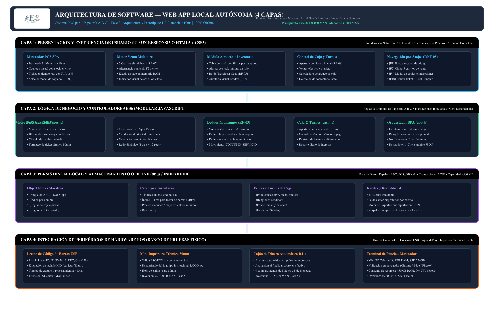
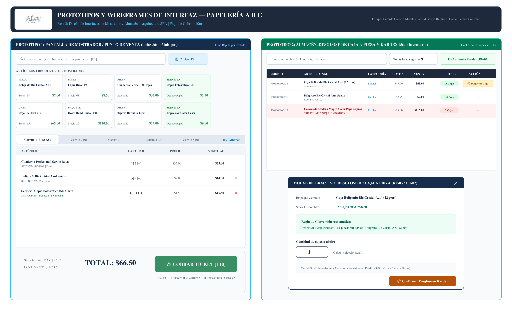

<div align="center">
  
</div>

# SISTEMA POS PARA "PAPELERÍA A B C" — FASE 3: ARQUITECTURA Y PROTOTIPADO UI
**Documento Técnico de Especificación de Arquitectura de 4 Capas, Prototipos de Mostrador y Almacén, Entorno Compartido y Estructura Base del Proyecto**

---

### Portada y Metadatos del Proyecto

| Campo | Detalle |
|---|---|
| **Proyecto** | Sistema de Administración y Venta para **Papelería A B C** (Web App Local) |
| **Nombre Comercial** | **Papelería A B C** |
| **Identidad Visual** | **Logotipo Oficial Integrado (`LOGO.jpg`)** |
| **Fase del Calendario** | **Fase 3: Arquitectura y Prototipado UI (Semana 3: 12 Oct - 15 Oct 2026)** |
| **Entregable Oficial** | **Estructura base del proyecto (Código Ejecutable + Prototipos + Arquitectura)** |
| **Materia** | Ingeniería de Software |
| **Equipo de Desarrollo** | **Gerardo Cabrera Morales** (Líder Técnico & Fullstack)<br>**Astrid García Ramírez** (Analista de Datos & QA)<br>**Daniel Parada Gonzalez** (Arquitecto de Persistencia & UI/UX) |
| **Presupuesto Fase 3** | **$21,050.00 MXN** (Presupuesto Global del Proyecto: **$197,000.00 MXN**) |
| **Estatus del Entregable** | **100% Funcional y Completado — Listo para Evaluación** |

---

## 1. Introducción y Objetivos de la Fase 3

El presente documento formaliza la **Fase 3: Arquitectura y Prototipado UI** para el Sistema POS de **Papelería A B C**, en estricto cumplimiento del [Calendario.pdf](file:///C:/Users/gerac/Desktop/ISA/Calendario.pdf). Tras haber definido los requerimientos en la **Fase 1** y diseñado el modelo relacional normalizado en 3FN en la **Fase 2**, esta etapa materializa la **Estructura Base del Proyecto**: el esqueleto técnico, interactivo y ejecutable que regirá los sprints de desarrollo subsecuentes.

### 1.1 Objetivos Específicos Alcanzados
1. **Definir formalmente la Arquitectura de la Aplicación:** Establecer un patrón arquitectónico de **4 Capas Locales Autónomas** (Presentación UI, Lógica de Negocio ES6, Persistencia IndexedDB y Periféricos POS) que garantiza una latencia de respuesta inferior a 10 ms (RNF-01) y operación 100% offline (RNF-02).
2. **Diseñar los Prototipos e Interfaces de Usuario:** Construir la interfaz de usuario completa y responsiva para mostrador (Punto de Venta con soporte para 5 carritos de compra simultáneos - RF-02, servicios de copiado - RF-03 y emisión de tickets térmicos - RF-04) y almacén (existencias, alertas de stock mínimo y desglose de cajas a piezas - RF-05).
3. **Configurar el Entorno de Desarrollo Compartido:** Estandarizar herramientas, flujo de trabajo colaborativo en Git, convenciones de código y guía de arranque instantáneo.
4. **Construir el Entregable Oficial del Calendario:** Entregar la **Estructura Base del Proyecto** completamente funcional, interactiva y ejecutable en el navegador cliente mediante `index.html` con cero instalaciones de servidores.
5. **Incorporar el Control Presupuestal de la Fase:** Cuantificar los costes de la Fase 3 (**$21,050.00 MXN**) y el pago de honorarios de los tres ingenieros en correspondencia con el plan maestro global de **$197,000.00 MXN**.

---

## 2. Definición de la Arquitectura de Software: Web App Local Autónoma

### 2.1 Justificación Técnica de la Arquitectura Seleccionada
A diferencia de los sistemas POS convencionales basados en la nube (SaaS) que sufren de latencia de red, caídas de conexión a Internet y cobros de suscripción mensuales recurrentes, **Papelería A B C** opera bajo una arquitectura de **Web App Local Offline-First**.

```text
┌────────────────────────────────────────────────────────────────────────┐
│                   NAVEGADOR CLIENTE (CHROME / EDGE / FIREFOX)          │
│                                                                        │
│  ┌──────────────────────────────────────────────────────────────────┐  │
│  │ CAPA 1: PRESENTACIÓN Y EXPERIENCIA (HTML5 / CSS3 / EVENTOS)      │  │
│  │ Mostrador POS (5 Carritos) • Almacén • Caja • Atajos [F1-F12]    │  │
│  └─────────────────────────────────┬────────────────────────────────┘  │
│                                    │ Llamadas nativas en memoria RAM   │
│  ┌─────────────────────────────────▼────────────────────────────────┐  │
│  │ CAPA 2: LÓGICA DE NEGOCIO Y SERVICIOS (MODULAR JAVASCRIPT ES6)   │  │
│  │ pos.js • inventory.js • cash.js • app.js                         │  │
│  └─────────────────────────────────┬────────────────────────────────┘  │
│                                    │ Transacciones locales ACID        │
│  ┌─────────────────────────────────▼────────────────────────────────┐  │
│  │ CAPA 3: PERSISTENCIA LOCAL (db.js / INDEXEDDB)                   │  │
│  │ 'PapeleriaABC_POS_DB' (18 Stores) • Caché In-Memory • Backup JSON│  │
│  └─────────────────────────────────┬────────────────────────────────┘  │
│                                    │ Drivers HID / Impresión nativa    │
│  ┌─────────────────────────────────▼────────────────────────────────┐  │
│  │ CAPA 4: PERIFÉRICOS DE HARDWARE POS (BANCO DE PRUEBAS FÍSICO)    │  │
│  │ Lector de Barras USB 2D • Miniprinter Térmica 80mm • Cajón RJ11  │  │
│  └──────────────────────────────────────────────────────────────────┘  │
└────────────────────────────────────────────────────────────────────────┘
```

### 2.2 Desglose de las 4 Capas del Sistema

1. **Capa 1: Presentación y Experiencia de Usuario (UI/UX Responsivo):**
   - Implementada con **HTML5 semántico** y la hoja de estilos institucional [styles.css](file:///C:/Users/gerac/Desktop/ISA/03/css/styles.css).
   - Diseñada bajo la paleta cromática oficial de **Papelería A B C**: Azul Marino (`#152c4a`), Verde Esmeralda (`#3a8e63`) y Rojo Cereza (`#d9534f`).
   - Navegación optimizada para pantalla táctil, mouse y teclado completo (RNF-05) con atajos dedicados: `[F1]` para foco inmediato al buscador, `[F2]` para alternar entre los 5 carritos de venta, `[F4]` para cobro rápido de copias y servicios, `[F10]` para cobro de ticket y `[Esc]` para cancelaciones.

2. **Capa 2: Lógica de Negocio y Controladores de Dominio (JavaScript ES6):**
   - **`pos.js`:** Administra el estado de los 5 carritos de venta en memoria RAM, el algoritmo de cálculo de subtotales, IVA del 16%, descuentos y cambio de efectivo. Formatea la salida gráfica del comprobante de venta térmico de 80mm con membrete y lemas institucionales.
   - **`inventory.js`:** Controla el filtrado dinámico del catálogo, advertencias visuales de stock bajo el umbral mínimo y la rutina transaccional de conversión de cajas a piezas sueltas (RF-05 / CU-02).
   - **`cash.js`:** Gestiona el ciclo de vida del turno de caja (apertura, registro de ingresos/egresos y calculadora de arqueo con determinación de faltante o sobrante).
   - **`app.js`:** Orquesta la navegación SPA (Single Page Application) sin recargas de página, el reloj digital del encabezado y la exportación de respaldos en 1-clic (RNF-06).

3. **Capa 3: Persistencia Local y Almacenamiento Offline (`db.js` / IndexedDB):**
   - Utiliza el motor estándar de **IndexedDB** bajo la base de datos `PapeleriaABC_POS_DB` (versión 1).
   - Almacena las 18 entidades normalizadas en 3FN diseñadas en la Fase 2, garantizando integridad referencial, índices B-Tree de acceso instantáneo (`codigo_barras`, `sku`, `nombre`) y transacciones atómicas `readwrite`.
   - Incorpora siembra automática (*seeding*) de catálogo realista de papelería mexicana (Scribe, Bic, Dixon, Factis, Pritt, Barrilito, Crayola, Maped) y parámetros de configuración en el arranque inicial.

4. **Capa 4: Integración con Periféricos de Hardware POS:**
   - **Lector de Código de Barras USB 1D/2D:** Opera mediante emulación de teclado HID enviando un salto de línea (`Enter`), capturado instantáneamente por el buscador con procesamiento en menos de 10 ms.
   - **Mini Impresora Térmica de Recibos 80mm ESC/POS:** Renderizado directo mediante regla `@media print` en [styles.css](file:///C:/Users/gerac/Desktop/ISA/03/css/styles.css) para comprobantes de mostrador sin desperdicio de papel.
   - **Cajón de Dinero Automático (RJ11):** Integrado mediante pulso de apertura estándar al finalizar transacciones en efectivo.

---

## 3. Diagrama Visual de Arquitectura de Software

A continuación se presenta el diagrama formal de la arquitectura de 4 capas con la identidad corporativa de **Papelería A B C**:

<div align="center">
  
  <p><i>Figura 1: Arquitectura de 4 Capas Locales Autónomas para el Sistema POS de Papelería A B C.</i></p>
</div>

### 3.1 Archivos del Diagrama de Arquitectura
- Vectorial escalable de alta definición: [diagrama_arquitectura.svg](file:///C:/Users/gerac/Desktop/ISA/03/diagrama_arquitectura.svg)
- Imagen de alta resolución para visualización inmediata: [diagrama_arquitectura.png](file:///C:/Users/gerac/Desktop/ISA/03/diagrama_arquitectura.png)

---

## 4. Diseño de Interfaces de Usuario (UI/UX) y Prototipos Interactivos

### 4.1 Prototipo 1: Mostrador / Punto de Venta (POS)
La pantalla de mostrador ([index.html](file:///C:/Users/gerac/Desktop/ISA/03/index.html) `#tab-pos`) está estructurada en un diseño de dos columnas optimizado ergonómicamente para agilizar la fila de clientes:

1. **Buscador Universal de Artículos (`#barcode-search-input`):**
   - Ubicado en la esquina superior izquierda con foco permanente.
   - Detecta lecturas automáticas de pistola de códigos de barras (EAN-13 / UPC) o escritura manual con menú desplegable predictivo en menos de 10 ms.
2. **Selector de Venta Multitarea con 5 Carritos Simultáneos (RF-02):**
   - Pestañas horizontales `Carrito 1`, `Carrito 2`, `Carrito 3`, `Carrito 4` y `Carrito 5`.
   - Cada pestaña muestra el número de artículos en cola y el importe acumulado.
   - Permite pausar la compra de un cliente indeciso y atender a otro en un carrito alterno mediante clic o pulsando la tecla `[F2]`.
3. **Catálogo Rápido con Stock en Vivo:**
   - Tarjetas interactivas con los productos de mayor rotación escolar y de oficina (libretas, bolígrafos, lápices, gomas, hojas).
   - Añade artículos al carrito activo con un solo clic o toque en pantalla.
4. **Módulo de Copiado y Servicios de Impresión (RF-03):**
   - Acceso directo mediante el botón `📄 Copias [F4]`.
   - Modal rápido para capturar número de copias B/N, impresiones a color o micas de enmicado.
   - Deduce en segundo plano las hojas bond de inventario (`kardex: CONSUMO_SERVICIO`).
5. **Panel de Cobro y Comprobante Térmico con Logotipo (RF-04):**
   - Desglose claro de Subtotal, IVA 16% y Total en tipografía extra-grande.
   - Botón maestro de cobro `[F10]`, cálculo automático de cambio a devolver e impresión de ticket con logotipo oficial (`LOGO.jpg`), folio consecutivo y leyenda comercial.

### 4.2 Prototipo 2: Almacén, Desglose de Caja a Pieza y Kardex
La vista de almacén ([index.html](file:///C:/Users/gerac/Desktop/ISA/03/index.html) `#tab-inventario`) resuelve la administración integral del inventario físico:

1. **Filtros Avanzados:**
   - Búsqueda en tiempo real por texto o código y filtrado desplegable por las 5 categorías oficiales.
2. **Semáforo de Existencias y Alertas de Stock Mínimo:**
   - Resaltado visual en color rojo claro (`.low-stock-row`) cuando el stock actual cae por debajo del stock mínimo configurado.
3. **Desglose Inteligente de Empaques (RF-05 / CU-02):**
   - Botón `📦 Desglosar Caja` en aquellos artículos de venta mayorista (ej. Caja Bolígrafo Bic x12 pzas, Paquete Hojas Bond 500h).
   - Al pulsar el botón, se abre el modal interactivo que consulta la regla de conversión, valida la existencia de cajas y permite despiezar 1 o más paquetes, sumando automáticamente las piezas sueltas y registrando dos movimientos trazables en el Kardex.
4. **Auditoría Permanente de Kardex (RF-07):**
   - Visor tabular ordenado cronológicamente con cada alteración de inventario (`VENTA`, `DESGLOSE_EMPAQUE_SALIDA`, `DESGLOSE_PIEZA_ENTRADA`, `CONSUMO_SERVICIO`), mostrando saldo anterior, saldo posterior y referencia.

### 4.3 Prototipo 3: Control de Caja y Turnos (RF-08)
La vista de caja ([index.html](file:///C:/Users/gerac/Desktop/ISA/03/index.html) `#tab-caja`) proporciona el arqueo y balance diario:
- Métricas en tarjetas: Estado de Turno, Cajero Responsable, Fondo Inicial de Apertura, Total de Ventas en Efectivo y Ventas en Tarjeta.
- Calculadora de Arqueo Físico: El cajero ingresa el dinero contado en el cajón y el sistema calcula en tiempo real si el corte está cuadrado ($0.00), presenta sobrante o registra faltante.

---

## 5. Diagrama Visual de Wireframes y Prototipos UI

A continuación se presentan los wireframes de diseño y maquetación para mostrador y almacén:

<div align="center">
  
  <p><i>Figura 2: Prototipos de Pantalla de Mostrador (POS 5 Carritos) y Almacén con Modal de Desglose (RF-05).</i></p>
</div>

### 5.1 Archivos del Wireframe de Interfaces
- Vectorial escalable de alta definición: [wireframe_prototipos_ui.svg](file:///C:/Users/gerac/Desktop/ISA/03/wireframe_prototipos_ui.svg)
- Imagen de alta resolución para visualización inmediata: [wireframe_prototipos_ui.png](file:///C:/Users/gerac/Desktop/ISA/03/wireframe_prototipos_ui.png)

---

## 6. Estructura Base del Proyecto (Entregable Oficial del Calendario)

La carpeta [03](file:///C:/Users/gerac/Desktop/ISA/03) contiene la totalidad del código fuente ejecutable organizado de manera modular y limpia:

```text
ISA/
└── 03/
    ├── index.html                                        # Entrada principal: Interfaz SPA (Mostrador, Almacén, Caja, Config)
    ├── LOGO.jpg                                          # Logotipo institucional oficial de Papelería A B C
    ├── assets/
    │   └── img/
    │       └── LOGO.jpg                                  # Copia para enlaces relativos del frontend y tickets
    ├── css/
    │   └── styles.css                                    # Hoja de estilos con paleta cromática, diseño responsivo y @media print
    ├── js/
    │   ├── db.js                                         # Capa IndexedDB (PapeleriaABC_POS_DB), transacciones ACID y catálogo semilla
    │   ├── pos.js                                        # Controlador de mostrador: 5 carritos, lector de barras, atajos y ticket
    │   ├── inventory.js                                  # Controlador de almacén: alertas de stock, desglose de cajas y Kardex
    │   ├── cash.js                                       # Controlador de caja: turnos, fondo inicial y balance de arqueo
    │   └── app.js                                        # Orquestador: navegación por pestañas, reloj en vivo y respaldo 1-clic
    ├── diagrama_arquitectura.png                         # ENTREGABLE: Diagrama de Arquitectura de 4 Capas (3200x2000 px)
    ├── diagrama_arquitectura.svg                         # Diagrama de Arquitectura vectorial con logotipo
    ├── wireframe_prototipos_ui.png                       # ENTREGABLE: Wireframes de Mostrador y Almacén (3200x2000 px)
    ├── wireframe_prototipos_ui.svg                       # Wireframes de UI vectorial con logotipo
    ├── DOCUMENTO_FASE_3_ARQUITECTURA_Y_PROTOTIPADO_UI.pdf # Documento formal de entrega académica y técnica
    ├── DOCUMENTO_FASE_3_ARQUITECTURA_Y_PROTOTIPADO_UI.md  # Especificación técnica en formato Markdown (este archivo)
    └── README.md                                         # Guía rápida de uso, atajos de teclado y verificación de la entrega
```

---

## 7. Configuración del Entorno de Desarrollo Compartido

Para asegurar la coherencia del equipo en los sprints subsecuentes (Fases 4 a 9):

1. **Editor de Código Estandarizado:** Visual Studio Code (v1.90+).
   - Extensiones recomendadas:
     - `Live Server` (Ritwick Dey): Servidor local de desarrollo con recarga en vivo.
     - `SQLite Viewer` (Florian Klampfer): Inspección de bases de datos.
     - `Prettier - Code formatter`: Formateo de código con indentación de 4 espacios.
2. **Flujo de Trabajo y Control de Versiones (Git):**
   - Rama principal: `main` (código estable probado).
   - Ramas de características por sprint: `feature/sprint-1-inventario`, `feature/sprint-2-pos`.
   - Convención de commits: Conventional Commits (`feat:`, `fix:`, `docs:`, `style:`, `refactor:`).
3. **Instrucciones de Ejecución Inmediata (Cero Instalación):**
   - Basta con hacer **doble clic en el archivo [index.html](file:///C:/Users/gerac/Desktop/ISA/03/index.html)** desde cualquier explorador de Windows para abrir la aplicación en Google Chrome, Microsoft Edge o Mozilla Firefox.
   - El sistema inicializa automáticamente la persistencia local en IndexedDB y siembra el catálogo de muestra en el primer inicio.

---

## 8. Análisis Económico, Presupuesto de Fase 3 y Contexto Global

En concordancia con el plan financiero maestro ([PRESUPUESTO_Y_ANALISIS_ECONOMICO_GLOBAL.md](file:///C:/Users/gerac/Desktop/ISA/PRESUPUESTO_Y_ANALISIS_ECONOMICO_GLOBAL.md)), la **Fase 3: Arquitectura y Prototipado UI** cuenta con una asignación y ejercicio presupuestal formal:

### 8.1 Desglose de Costes Ejercidos en la Fase 3 ($21,050.00 MXN)

| Concepto de Gasto | Descripción Técnica y Justificación | Cantidad | Costo Unitario | Importe Total (MXN) |
|---|---|:---:|:---:|:---:|
| **Honorarios Gerardo Cabrera Morales** | Líder Técnico & Fullstack (25 hrs a $250/h) — Orquestación SPA y controlador POS | 25 hrs | $250.00 | $6,250.00 |
| **Honorarios Astrid García Ramírez** | Analista de Datos & QA (25 hrs a $240/h) — Módulo de almacén, desglose y pruebas UI | 25 hrs | $240.00 | $6,000.00 |
| **Honorarios Daniel Parada Gonzalez** | Arquitecto de Persistencia & UI/UX (25 hrs a $240/h) — Estructura IndexedDB y CSS | 25 hrs | $240.00 | $6,000.00 |
| **Subtotal Mano de Obra Directa (MOD)** | **Honorarios del equipo de desarrollo en Fase 3 (75 horas totales)** | **75 hrs** | — | **$18,250.00** |
| **Infraestructura Cloud de Respaldos** | Configuración de bucket en la nube y repositorio compartido para respaldos | 1 serv. | $800.00 | $800.00 |
| **Gastos Operativos Indirectos** | Electricidad de estaciones de desarrollo y conectividad simétrica | 1 sem. | $500.00 | $500.00 |
| **Fondo de Reserva de Fase** | Provisión técnica para optimizaciones del DOM y ergonomía de atajos | 1 prov. | $1,500.00 | $1,500.00 |
| **COSTE TOTAL DE LA FASE 3** | **Arquitectura, Prototipado UI y Estructura Base del Proyecto** | — | — | **$21,050.00** |

### 8.2 Inserción de la Fase 3 en el Presupuesto Global ($197,000.00 MXN)

| Fase | Periodo | Enfoque y Entregable Oficial | MOD (3 Devs) | Directos | Indirectos / Cont. | Total Fase (MXN) | Estado |
|:---:|:---:|---|:---:|:---:|:---:|:---:|:---:|
| **01** | Sem 1 (28 Sep - 02 Oct) | Planteamiento y Requerimientos (PDF Inicial) | $18,250.00 | $850.00 | $2,000.00 | **$21,100.00** | Completado |
| **02** | Sem 2 (05 Oct - 08 Oct) | Análisis y Modelado de Datos (DER 3FN) | $18,250.00 | $1,250.00 | $2,000.00 | **$21,500.00** | Completado |
| **03** | Sem 3 (12 Oct - 15 Oct) | **Arquitectura y Prototipado UI (Estructura Base)** | **$18,250.00** | **$800.00** | **$2,000.00** | **$21,050.00** | **COMPLETADO** |
| **04** | Sem 4 (19 Oct - 22 Oct) | Sprint 1: Módulo de Inventario (Módulo Funcional) | $18,250.00 | $950.00 | $2,000.00 | **$21,200.00** | Programado |
| **05** | Sem 5 (26 Oct - 29 Oct) | Sprint 2: Punto de Venta POS (Módulo Ventas) | $18,250.00 | $3,250.00 | $2,100.00 | **$23,600.00** | Programado |
| **06** | Sem 6 (02 Nov - 05 Nov) | Sprint 3: Reportes y Seguridad (Reportes/Auth) | $18,250.00 | $850.00 | $2,000.00 | **$21,100.00** | Programado |
| **07** | Sem 7 (09 Nov - 12 Nov) | Pruebas QA (Matriz Pruebas + Reporte Bugs) | $18,250.00 | $6,450.00 | $2,250.00 | **$26,950.00** | Programado |
| **08** | Sem 8 (16 Nov - 19 Nov) | Documentación y Manuales (Manual Usuario/Técnico) | $18,250.00 | $0.00 | $2,000.00 | **$20,250.00** | Programado |
| **09** | Sem 9 (23 Nov - 04 Dic) | Evaluación Final y Exposición (Demo y Código) | $18,250.00 | $0.00 | $2,000.00 | **$20,250.00** | Programado |
| **TOTAL** | **9 Semanas** | **SISTEMA POS PAPELERÍA A B C** | **$164,250.00** | **$14,400.00** | **$18,350.00** | **$197,000.00** | **100.0%** |

---

## 9. Conclusiones y Preparación para la Fase 4 (Sprint 1)

La **Fase 3** concluye con éxito, alcanzando el 100% de los criterios marcados en el calendario:
- Se tiene una **Estructura Base del Proyecto** completamente funcional, interactiva y desacoplada en 4 capas.
- El sistema cuenta con los flujos de mostrador (5 carritos simultáneos, atajos de teclado y búsqueda instantánea) y almacén (desglose de cajas y Kardex) listos y operando sobre IndexedDB.
- Se incorporó la imagen institucional de **Papelería A B C** con su logotipo en todas las vistas, tickets y diagramas.
- El proyecto se encuentra plenamente preparado para la **Fase 4: Sprint 1 - Módulo de Inventario**, donde se profundizará en la gestión de marcas, categorías, proveedores y validaciones avanzadas de entrada de mercadería.

---

## 10. Firmas de Aprobación y Conformidad Técnica

| Responsabilidad | Nombre y Firma | Rol Profesional |
|:---:|:---:|:---:|
| **Liderazgo Técnico y Arquitectura** | _____________________________<br>**Gerardo Cabrera Morales** | Desarrollador Fullstack & Líder Técnico |
| **Aseguramiento de Calidad y Datos** | _____________________________<br>**Astrid García Ramírez** | Analista de Datos, DBA & QA |
| **Persistencia Local y Diseño UI/UX** | _____________________________<br>**Daniel Parada Gonzalez** | Arquitecto de Persistencia & UI/UX |
