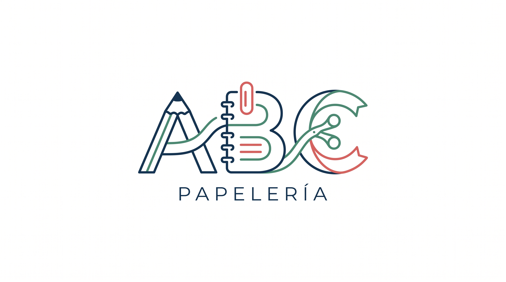

# PAPELERÍA A B C — SISTEMA INTEGRAL DE ADMINISTRACIÓN Y PUNTO DE VENTA (POS)
## CARPETA DE ENTREGA 04: FASE 4 — SPRINT 1 (MÓDULO DE INVENTARIO)
### Semana 4: 19 de Octubre al 22 de Octubre de 2026

---



Bienvenido a la carpeta oficial de entrega **`04/`**, correspondiente a la **Fase 4 (Sprint 1: Módulo de Inventario)** del sistema de administración y ventas de **Papelería A B C**, en estricto cumplimiento con el cronograma maestro establecido en `Calendario.pdf`.

Esta fase entrega el **Módulo de Inventario 100% funcional y operativo**, desarrollado bajo una arquitectura **Local Offline-First** (HTML5 + CSS3 + JavaScript ES6 + IndexedDB), capaz de operar sin conexión a Internet con latencias inferiores a 10 milisegundos y sin costos recurrentes de servidores o bases de datos de pago.

---

## 1. CONTENIDO Y ESTRUCTURA DE LA ENTREGA EN `04/`

> [!NOTE]
> **Integración Progresiva y Repositorio Final:**
> El módulo de inventario entregado en esta carpeta ha sido integrado armónicamente con el mostrador POS y control de caja en el entregable consolidado [`ENTREGA/`](file:///C:/Users/gerac/Desktop/ISA/ENTREGA). Para conocer los detalles de diseño conciliados para el cliente final, consulte la [Nota Técnica de Integración y Reconciliación UI](file:///C:/Users/gerac/Desktop/ISA/04/NOTA_DE_INTEGRACION_Y_RECONCILIACION_GUI.md).

```
C:\Users\gerac\Desktop\ISA\04\
│
├── LOGO.jpg                                        # Logotipo oficial de Papelería A B C
├── NOTA_DE_INTEGRACION_Y_RECONCILIACION_GUI.md     # Documento de reconciliación de interfaz para el cliente
├── index.html                                      # Interfaz gráfica principal (SPA reactiva de inventario)
├── README.md                                       # Este documento índice de la entrega
├── papeleria_pos.db                                # Base de datos SQLite 3 oficial (160 productos, 3FN)
├── GUIA_HERRAMIENTAS_E_INSTALACION.md              # Guía de instalación de Live Server y DBeaver
├── DOCUMENTO_FASE_4_SPRINT_1_MODULO_INVENTARIO.md  # Memoria técnica completa en Markdown
├── DOCUMENTO_FASE_4_SPRINT_1_MODULO_INVENTARIO.pdf # Documento formal oficial compilado (6 páginas)
│
├── database/
│   ├── papeleria_pos.db                            # Base de datos SQLite 3 para abrir en DBeaver / SQLiteStudio
│   └── papeleria_pos.sql                           # Script DDL + DML completo con 160 productos
│
├── diagrama_modulo_inventario.png                  # Diagrama de arquitectura de 4 capas (Render 200 DPI)
├── diagrama_modulo_inventario.svg                  # Diagrama vectorial editable de arquitectura
├── flujo_entradas_mermas.png                       # Diagrama de flujo de compras, mermas y kardex
├── flujo_entradas_mermas.svg                       # Diagrama vectorial editable de flujos
│
├── assets/
│   ├── data/
│   │   └── catalog_160.json                        # Catálogo maestro de 160 productos en JSON
│   └── img/
│       └── LOGO.jpg                                # Copia de respaldo del logotipo corporativo
│
├── css/
│   └── styles.css                                  # Hoja de estilos con la paleta de Papelería A B C
│
└── js/
    ├── app.js                                      # Orquestador principal, reloj en vivo y atajos F1/F2
    ├── db.js                                       # Motor Relacional SQL Local & Persistencia Híbrida
    ├── inventory.js                                # Catálogo, filtros, alertas de stock mínimo y EAN-13
    ├── catalog_masters.js                          # Gestión CRUD de 12 Marcas y 8 Categorías de papelería
    ├── stock_movements.js                          # Registro de compras, desincorporación de mermas y kardex
    └── import_export.js                            # Intercambio en CSV Excel (BOM UTF-8) y snapshot JSON 1-clic
```

---

## 2. PUESTA EN MARCHA RÁPIDA (EJECUCIÓN DEL MÓDULO)

El módulo no requiere compilar código ni ejecutar comandos complejos:

### Método 1: Ejecución Directa con Navegador (Inmediata)
1. Navegue a la carpeta: `C:\Users\gerac\Desktop\ISA\04`
2. Haga **doble clic** sobre el archivo `index.html`.
3. El sistema se abrirá inmediatamente en su navegador predeterminado (Google Chrome, Microsoft Edge, Firefox, Brave) con la base de datos IndexedDB inicializada y el catálogo completo de **160 artículos reales pre-cargados** (4,509 unidades en anaquel, 8 categorías comerciales y 12 marcas líderes). Incluye botón directo **"Sincronizar Catálogo (160 Arts.)"** para recargar o restablecer en cualquier momento.

### Método 2: Mediante Live Server en Visual Studio Code (Recomendado para Desarrollo)
1. Abra la carpeta `04` en VS Code.
2. Haga clic derecho sobre `index.html` y seleccione **"Open with Live Server"**.
3. El sistema correrá en la dirección local: `http://127.0.0.1:5500/index.html`.
*(Consulte la [Guía de Herramientas e Instalación](file:///C:/Users/gerac/Desktop/ISA/04/GUIA_HERRAMIENTAS_E_INSTALACION.md) para más detalles).*

---

## 3. ATAJOS DE TECLADO OPERATIVOS PARA MOSTRADOR Y ALMACÉN

Para acelerar la atención a clientes y la auditoría de anaqueles, se programaron atajos globales en el teclado:

| Tecla / Atajo | Acción en el Sistema |
| :---: | :--- |
| **`[F1]`** | Coloca el cursor inmediatamente en el buscador de productos para ingresar un nombre, código de barras o disparar el lector láser. |
| **`[F2]`** | Despliega la ventana modal para registrar un **Nuevo Artículo** en el catálogo con cálculo de utilidad y generador de EAN-13. |
| **`[Esc]`** | Cierra cualquier modal o cuadro de diálogo activo en pantalla. |

---

## 4. MÓDULOS Y FUNCIONALIDADES IMPLEMENTADAS

1. **📦 Catálogo de Productos y Monitor de Stock:**
   - Tabla reactiva con indicadores cromáticos de stock óptimo (verde) y stock crítico (rojo `#fff1f2`).
   - Búsqueda instantánea en tiempo real combinada con filtros por marca y categoría.
   - Generador automático de códigos de barras EAN-13 simulados con prefijo mexicano (`750...`) para productos a granel.
   - Validaciones estrictas: unicidad de código de barras y SKU, valores no negativos y advertencia si el costo supera el precio de venta.
2. **🏷️ Marcas y Categorías Homologadas:**
   - Maestro de 12 marcas líderes (Scribe, Bic, Dixon, Factis, Barrilito, Pritt, Crayola, Maped, Pilot, Paper Mate, Baco, Berol).
   - Maestro de 8 categorías especializadas (Cuadernos, Escritura, Adhesivos, Papeles, Geometría, Arte, Archivo, Servicios).
3. **📥 Entradas / Compras de Mercancía:**
   - Captura de compras a mayoristas con proveedor, número de factura y costo unitario.
   - Cálculo reactivo de la inversión total y actualización inmediata de existencias en anaquel.
4. **📉 Registro de Mermas y Bajas (RF-04):**
   - Desincorporación de artículos dañados, caducados (tintas/pegamentos) o con defecto de fábrica.
   - **Validación Infranqueable:** El sistema bloquea cualquier baja que supere el stock físico actual.
   - Justificación legal obligatoria y registro del responsable de turno.
5. **📋 Kardex Auditable e Inmutable (RF-07):**
   - Libro mayor contable que registra cada movimiento con marca temporal ISO exacta, stock previo y posterior.
   - Filtros por producto y tipo de transacción (`ENTRADA_COMPRA`, `MERMA_BAJA`, etc.).
6. **🔄 Carga Masiva y Respaldos (RF-06 / RNF-06):**
   - Exportación e importación en formato CSV con soporte de acentos en Microsoft Excel (BOM UTF-8).
   - Descarga de plantilla CSV muestra.
   - Botón de **Respaldo Rápido en 1-Clic** que genera un snapshot completo de los 10 Object Stores en formato JSON.

---

## 5. RESUMEN FINANCIERO DE LA FASE 4

- **Costo Específico de la Fase 4:** **$21,200.00 MXN**
  - *Mano de Obra Directa (MOD - 75 horas hombre de 3 desarrolladores):* $18,250.00 MXN (86.08%)
  - *Materiales e Insumos Directos (etiquetas térmicas, rollos 58mm y formatos):* $950.00 MXN (4.48%)
  - *Costos Indirectos y Fondo de Contingencia:* $2,000.00 MXN (9.43%)
- **Presupuesto Total del Proyecto:** **$197,000.00 MXN**
- **Inversión Acumulada Devengada:** **$87,000.00 MXN** (Fases 1, 2, 3 y 4 completadas al 100% — 44.16% de avance financiero).

---

## 6. EQUIPO TÉCNICO DESARROLLADOR

- **Gerardo Cabrera Morales** — Líder Técnico & Ingeniero Fullstack
- **Astrid García Ramírez** — Analista de Datos & Ingeniera de QA
- **Daniel Parada Gonzalez** — Arquitecto de Persistencia & Diseñador UI/UX

---

*Papelería A B C — Tu papelería de confianza. Sistema desarrollado conforme a los requerimientos de la Fase 4 del Calendario Oficial de Entregas.*
