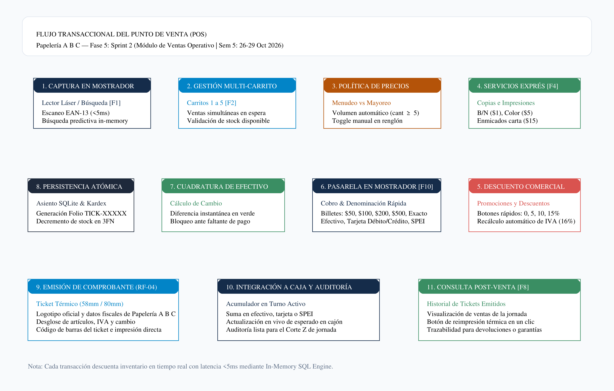
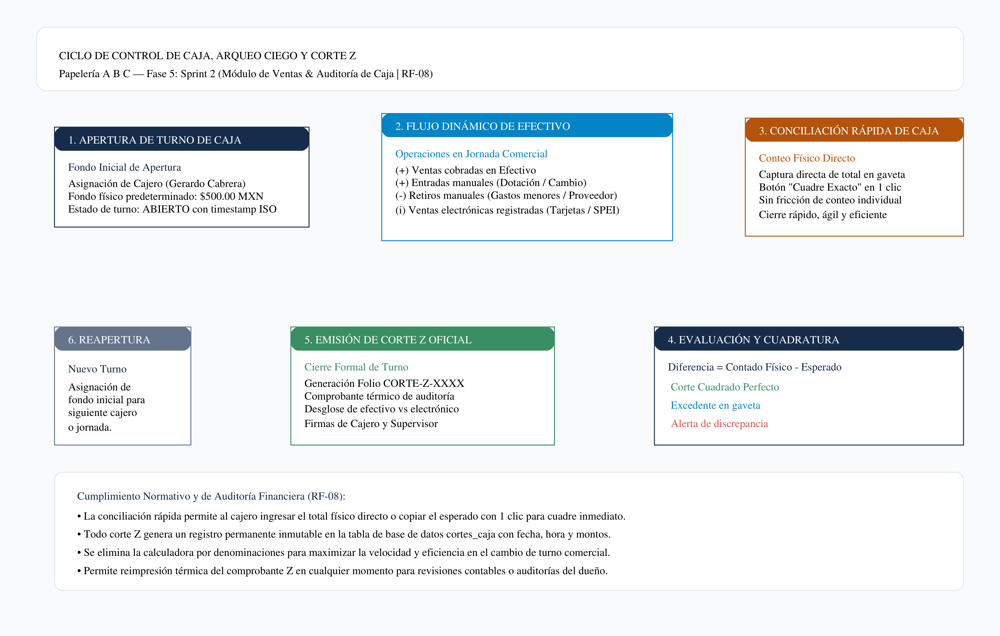

# SISTEMA INTEGRAL DE ADMINISTRACIÓN Y PUNTO DE VENTA (POS)
## ENTREGABLE OFICIAL DE LA FASE 5: SPRINT 2 — MÓDULO DE VENTAS Y PUNTO DE VENTA (POS)
### PAPELERÍA A B C

---

| **Metadato Institucional** | **Detalle de la Entrega Técnica** |
| :--- | :--- |
| **Organización / Establecimiento:** | **Papelería A B C** |
| **Identidad Corporativa:** | Paleta oficial Azul Marino (`#152c4a`), Verde Esmeralda (`#3a8e63`), Rojo Alertas (`#d9534f`), Blanco/Gris Neutro (`#f8fafc`). Logotipo oficial integrado (`LOGO.jpg`). |
| **Fase del Calendario:** | **Fase 5: Sprint 2 (Semana 5: 26 de Octubre al 29 de Octubre de 2026)** |
| **Hito Contractual:** | **Sprint 2: Punto de Venta (POS)** |
| **Entregable Oficial Exigido:** | **Módulo de Ventas operativo** con pantalla de venta rápida con soporte de lector de barras, cálculo de totales, cambio, descuentos, control de caja y generación simulada de comprobante/ticket de venta. |
| **Modalidad de Arquitectura:** | Web Application Local Offline-First (HTML5 + CSS3 + ES6 + SQLite 3 Relacional 3FN con Motor Síncrono In-Memory y Espejo LocalStorage). Autonomía total sin conexión a Internet y latencia de respuesta `< 5 ms`. |
| **Presupuesto Económico Fase 5:** | **$23,600.00 MXN** (Desglosado en MOD para 3 desarrolladores, miniprinter térmica 80mm, cajón metálico RJ11, rollos de papel térmico e indirectos/contingencia). |
| **Inversión Global Acumulada:** | **$108,450.00 MXN devengados** de un costo total del proyecto de **$197,000.00 MXN** (55.05% de avance financiero). |
| **Equipo Desarrollador:** | **Gerardo Cabrera Morales** (Líder Técnico & Fullstack)<br>**Astrid García Ramírez** (Analista de Datos & QA)<br>**Daniel Parada Gonzalez** (Arquitecto de Persistencia & UI/UX) |

---

## 1. RESUMEN EJECUTIVO Y ALCANCE DEL SPRINT 2

En estricto cumplimiento del cronograma maestro establecido en el `Calendario.pdf` para **Papelería A B C**, la **Fase 5 (Sprint 2: Punto de Venta POS)** representa la puesta en marcha del núcleo transaccional de cara al cliente y al mostrador comercial.

El Módulo de Ventas desarrollado resuelve integralmente la dinámica de atención ágil y de alto flujo en papelería:

1. **Velocidad de Mostrador y Adición Silenciosa sin Fricciones:** Lectura instantánea de códigos de barras EAN-13 en menos de 5 milisegundos mediante el motor relacional en memoria pre-indexado. La captura de artículos se realiza de forma silenciosa y continua (sin alertas flotantes intrusivas), permitiendo escanear ráfagas de productos sin perder el foco del cursor.
2. **Ergonomía de Mostrador y Pie de Carrito Fijo (Sticky Cart Footer):** El panel de ventas cuenta con un contenedor de artículos con desplazamiento vertical (`scroll`) independiente y cabeceras de tabla congeladas. El pie de página que aloja el desglose de totales y el botón **"Cobrar Ticket [F10]"** permanece anclado fijamente en la parte inferior de la pantalla (`position: sticky`), impidiendo que una orden extensa con decenas de artículos desplace el botón fuera de la vista del cajero.
3. **Cobro Ultra-Rápido con Enfoque Automático:** Al presionar `[F10]` o hacer clic en Cobrar Ticket, el modal sitúa inmediatamente el foco en el campo **"Monto Recibido del Cliente"** con selección automática de texto, permitiendo ingresar el dinero entregado directamente con el teclado numérico o confirmar en un instante pulsando la tecla `Enter`.
4. **Atención Simultánea con 5 Carritos Independientes (RF-02):** Mecanismo de venta en espera que permite alternar con una sola tecla (`F2`) entre hasta 5 clientes concurrentes, evitando que la indecisión o búsqueda de un artículo por parte de un cliente detenga la fila de cobro.
5. **Esquema de Precios Diferenciados (Menudeo vs. Mayoreo):** Detección inteligente por volumen (cuando la cantidad es $\ge 5$ piezas) o alternancia manual mediante botón directo para aplicar el precio de mayoreo registrado en el catálogo con badge distintivo `[MAYOREO]`.
6. **Descuentos Comerciales y Promociones:** Selector rápido de descuentos en un clic (0%, 5%, 10%, 15% o personalizado) con recálculo automático de la base gravable y del IVA trasladado del 16%.
7. **Pasarela de Cobro y Calculadora de Cambio:** Botones de denominaciones rápidas de efectivo ($50, $100, $200, $500, $1,000 y Pago Exacto), cálculo automático de cambio en color verde esmeralda y soporte de métodos de pago (Efectivo, Tarjeta y Transferencia SPEI).
8. **Emisión de Comprobante / Ticket Térmico con Identidad Corporativa (RF-04):** Impresión y previsualización de ticket térmico estándar (58mm / 80mm) con el logotipo de Papelería A B C, datos fiscales (RFC `PABC261005ABC`), dirección, teléfono, folio único consecutivo, desglose de IVA, código de barras del ticket y leyenda de cortesía.
9. **Centro Ejecutivo de Análisis e Historial de Ventas (`[F8]`):** Consola ampliada a 1,040 px de ancho con visualización en tiempo real de indicadores clave (KPIs): Total de Transacciones, Recaudación Total, Ticket Promedio y Distribución de Pagos (Efectivo vs. Electrónico). Incorpora barra de búsqueda instantánea por folio, cajero o producto vendido, además de filtros combinables por método de pago y rango temporal (turno actual, hoy, 7 días, 30 días o histórico completo).
10. **Exportación Oficial de Ventas a CSV para Microsoft Excel:** Generación y descarga directa del archivo `ventas_del_dia_YYYY-MM-DD.csv` con codificación UTF-8 y marca de orden de bytes (BOM `\uFEFF`), asegurando compatibilidad nativa e inmediata con Microsoft Excel sin distorsión de caracteres.
11. **Conciliación Rápida de Efectivo y Corte Z (RF-08):** Eliminación de la calculadora de 11 denominaciones individuales para acelerar los cambios de turno comercial. Se implementó un flujo ágil de captura directa del efectivo en gaveta complementado con el botón de 1 solo clic **"[Cuadre Exacto (Copiar Monto del Sistema)]"**, cálculo instantáneo de discrepancias ($0.00, Sobrante o Faltante) y emisión oficial del **Corte de Turno (Reporte Z)** con firmas de cajero y supervisor.
12. **Kárdex Transaccional Atómico:** Cada ticket cobrado descuenta inmediatamente las existencias del catálogo en la base de datos relacional y genera un asiento formal inmutable en `kardex_inventario` con tipo `VENTA_MOSTRADOR`.
13. **Estándar Corporativo Estricto Cero Emojis:** Interfaz de usuario, comprobantes impresos, reportes y documentación técnica diseñados bajo normas institucionales de sobriedad y profesionalismo, sin inclusión de emojis informales.

---

## 2. DESGLOSE ECONÓMICO Y PRESUPUESTO FINANCIERO

El costo global presupuestado para el desarrollo integral del sistema asciende a **$197,000.00 MXN**. A continuación se detalla la aplicación presupuestal específica de la **Fase 5 (Sprint 2 - Punto de Venta POS)**, la cual totaliza **$23,600.00 MXN** (11.98% del total).

### 2.1 Presupuesto Detallado de la Fase 5 ($23,600.00 MXN)

#### A. Mano de Obra Directa (MOD) — 3 Ingenieros de Software (75 Horas)
La ejecución del Sprint 2 demandó 75 horas de trabajo de ingeniería distribuidas equitativamente:

| Desarrollador / Especialidad | Horas | Tarifa / Hora | Subtotal MOD | Responsabilidades Específicas en Sprint 2 (Ventas POS) |
| :--- | :---: | :---: | :---: | :--- |
| **Gerardo Cabrera Morales**<br>*Líder Técnico & Fullstack* | 25 hrs | $250.00 MXN | $6,250.00 MXN | Algoritmo multicarrito, escaneo de lector láser, atajos de teclado (F1, F2, F4, F8, F10, Esc), integración del motor de cobro con autofoco, pie fijo de carrito (`sticky`) y calculadora de cambio (`pos.js`). |
| **Daniel Parada Gonzalez**<br>*Arquitecto de Persistencia & UI/UX* | 25 hrs | $240.00 MXN | $6,000.00 MXN | Diseño responsivo de mostrador sin desplazamiento de botones, consola de análisis de tickets a 1040px con métricas KPI, maquetación de tickets térmicos con logotipo y reglas `@media print`. |
| **Astrid García Ramírez**<br>*Analista de Datos, DBA & QA* | 25 hrs | $240.00 MXN | $6,000.00 MXN | Lógica de auditoría de caja (`cash.js`), conciliación rápida con botón cuadre exacto, exportación CSV con UTF-8 BOM, persistencia SQLite 3 y matriz de pruebas E2E. |
| **SUBTOTAL MANO DE OBRA DIRECTA:** | **75 hrs** | — | **$18,250.00 MXN** | *(77.33% del presupuesto de la Fase 5)* |

#### B. Hardware, Equipamiento y Periféricos POS Adquiridos en Fase 5
Para garantizar que el software interactúe fielmente con el hardware de mostrador de Papelería A B C, se adquirieron los siguientes componentes físicos para el banco de pruebas:

| Periférico / Insumo | Especificaciones Técnicas | Costo Unitario | Subtotal | Justificación Operativa |
| :--- | :--- | :---: | :---: | :--- |
| **Mini Impresora Térmica 80mm** | Conexión USB, cortador automático, comandos ESC/POS estándar, 200 mm/s. | $2,100.00 MXN | $2,100.00 MXN | Calibración de salida física del ticket térmico de venta con logotipo y código de barras. |
| **Cajón de Dinero Automático Metálico** | Ranura de 4 billetes / 8 monedas, conexión RJ11 a miniprinter, apertura por pulso eléctrico. | $1,150.00 MXN | $1,150.00 MXN | Validación de apertura automática de gaveta al confirmar cobro en efectivo. |
| **Rollos de Papel Térmico Grado POS 80mm** | Papel térmico libre de BPA, 80mm × 70m (Caja con 10 rollos de prueba). | $350.00 MXN | $350.00 MXN | Pruebas continuas de impresión de tickets de mostrador y comprobantes de corte Z. |
| **SUBTOTAL HARDWARE E INSUMOS:** | — | — | **$3,600.00 MXN** | *(15.25% del presupuesto de la Fase 5)* |

#### C. Costos Indirectos de Operación y Reserva de Contingencia
| Concepto Indirecto | Asignación Fase 5 | Justificación Técnica |
| :--- | :---: | :--- |
| **Energía Eléctrica y Red LAN Gigabit de Laboratorio** | $900.00 MXN | Consumo energético de los equipos de desarrollo y conectividad simétrica. |
| **Fondo de Contingencia Técnica (Sprint 2)** | $850.00 MXN | Reserva para ajustes de controladores USB y pruebas de papel térmico. |
| **SUBTOTAL INDIRECTOS Y CONTINGENCIA:** | **$1,750.00 MXN** | *(7.42% del presupuesto de la Fase 5)* |

$$\mathbf{TOTAL\ INVERSIÓN\ FASE\ 5\ (SPRINT\ 2\ POS):\ \$23,600.00\ MXN}$$

---

### 2.2 Estado Financiero Consolidado del Proyecto ($197,000.00 MXN)

Con el cierre y entrega de esta Fase 5, el estado económico del proyecto para **Papelería A B C** alcanza el **55.05% de avance financiero devengado**:

| Fase | Periodo Oficial | Nombre de la Fase y Entregable | Costo Fase | Estado Financiero | % Acumulado |
| :---: | :---: | :--- | :---: | :---: | :---: |
| **01** | Sem 1 (28 Sep - 02 Oct) | Planteamiento y Requerimientos | $21,100.00 MXN | **Devengado (100%)** | 10.71% |
| **02** | Sem 2 (05 Oct - 08 Oct) | Análisis y Modelado de Datos (DER 3FN) | $21,500.00 MXN | **Devengado (100%)** | 21.62% |
| **03** | Sem 3 (12 Oct - 15 Oct) | Arquitectura y Prototipado UI | $21,050.00 MXN | **Devengado (100%)** | 32.31% |
| **04** | Sem 4 (19 Oct - 22 Oct) | Sprint 1: Módulo de Inventario | $21,200.00 MXN | **Devengado (100%)** | 43.07% |
| **05** | **Sem 5 (26 Oct - 29 Oct)** | **Sprint 2: Punto de Venta (POS)** | **$23,600.00 MXN** | **Devengado (100%)** | **55.05%** |
| *06* | *Sem 6 (02 Nov - 05 Nov)* | *Sprint 3: Reportes y Seguridad* | *$21,100.00 MXN* | *Programado* | *65.76%* |
| *07* | *Sem 7 (09 Nov - 12 Nov)* | *Pruebas de Software (QA)* | *$26,950.00 MXN* | *Programado* | *79.44%* |
| *08* | *Sem 8 (16 Nov - 19 Nov)* | *Documentación y Manuales* | *$20,250.00 MXN* | *Programado* | *89.72%* |
| *09* | *Sem 9 (23 Nov - 04 Dic)* | *Evaluación Final y Entrega* | *$20,250.00 MXN* | *Programado* | *100.00%* |
| **TOTAL** | **9 Semanas** | **PROYECTO COMPLETO PAPELERÍA A B C** | **$197,000.00 MXN** | **$108,450.00 DEVENGADOS** | **100.00%** |

---

## 3. ARQUITECTURA TÉCNICA DEL MÓDULO DE VENTAS POS

El Módulo de Punto de Venta se construyó siguiendo una arquitectura desacoplada y orientada a eventos para garantizar reactividad inmediata:

```
+-----------------------------------------------------------------------------------------+
|                  CAPA 1: PRESENTACIÓN Y ERGONOMÍA DE MOSTRADOR (HTML5 + CSS3)            |
| [Lector Láser F1]  [Carritos 1 a 5 F2]  [Copias F4]  [Cobro F10 Fijo]  [Historial F8 1040px] |
+--------------------------------------------+--------------------------------------------+
                                             | Disparo de eventos reactivos
                                             v
+-----------------------------------------------------------------------------------------+
|                CAPA 2: LÓGICA DE NEGOCIO Y CONTROLADORES (pos.js & cash.js)             |
| - Gestión multicarrito y memoria volátil     - Detección de volumen y precios mayoreo   |
| - Descuentos comerciales (0% a 15%)          - Calculadora de cambio con autofoco       |
| - Generador de tickets térmicos 58/80mm     - Conciliación rápida y Corte Z directo    |
| - Centro de análisis con métricas KPI       - Exportador de ventas CSV con UTF-8 BOM   |
+--------------------------------------------+--------------------------------------------+
                                             | Transacciones síncronas
                                             v
+-----------------------------------------------------------------------------------------+
|             CAPA 3: MOTOR RELACIONAL SÍNCRONO CLIENTE (db.js & LocalStorage)            |
| - Catálogo de 160 productos indexado         - Tabla de ventas y detalle_ventas         |
| - Registro inmutable de Kárdex               - Turnos de caja y movimientos_caja        |
+--------------------------------------------+--------------------------------------------+
                                             | Respaldo físico portable
                                             v
+-----------------------------------------------------------------------------------------+
|           CAPA 4: BASE DE DATOS RELACIONAL ESTÁNDAR 3FN (SQLite 3 papeleria_pos.db)     |
| 16 tablas relacionales con integridad referencial, llaves foráneas y scripts ANSI SQL    |
+-----------------------------------------------------------------------------------------+
```

### Componentes de Software Desarrollados en el Sprint:
* **`pos.js` (Controlador de Mostrador y Ergonomía):** Administra el escaneo con lector de código de barras de adición silenciosa, atajos de teclado profesionales (`F1`, `F2`, `F4`, `F8`, `F10`, `Esc`), alternancia entre los 5 carritos, lógica de precios de mayoreo, descuentos porcentuales, modal de cobro con autofoco y auto-selección en monto recibido, cálculo de cambio en tiempo real, centro de análisis con filtrado multicriterio (`filtrarHistorialVentas()`), y renderizado de tickets.
* **`cash.js` (Controlador de Caja y Conciliación Rápida):** Controla la apertura y cierre de turnos, el fondo inicial de $500.00 MXN, entradas y retiros manuales de efectivo, la conciliación rápida mediante conteo directo en gaveta y el botón `copiarMontoEsperado()` para cuadre exacto en 1 clic, balance de discrepancias y emisión formal del Reporte Z.
* **`import_export.js` (Exportación e Interoperabilidad):** Aloja la función oficial `exportarVentasDiaCSV()`, la cual estructura las transacciones de venta del turno o jornada en un archivo plano CSV delimitado por comas, precedido de la marca UTF-8 BOM (`\uFEFF`) para visualización instantánea y sin defectos ortográficos en Microsoft Excel.
* **`db.js` (Capa de Datos y Kárdex):** Métodos transaccionales `registrarVentaConKardex`, `getHistorialVentas`, `getVentaPorFolio`, `registrarMovimientoCaja`, `registrarCorteTurno` y `reabrirNuevoTurno`.
* **`index.html` (Estructura Semántica de Interfaz):** Vistas especializadas para POS, Almacén, Caja y Configuración, complementadas con modales para Cobro, Ticket Térmico, Servicios de Copias, Historial Ejecutivo de Ventas (1040px con KPIs), Movimientos de Caja y Comprobante de Corte Z.
* **`styles.css` (Diseño Ergonómico y Paleta Corporativa):** Estilos cromáticos institucionales de Papelería A B C, reglas de pie de página de carrito fijo (`position: sticky; bottom: 0;`), tabla de productos con desplazamiento vertical aislado y cabeceras congeladas, badges de mayoreo sobrios, botones de denominación rápida y reglas `@media print` para impresoras térmicas.

---

## 4. ESPECIFICACIÓN DE HISTORIAS DE USUARIO (SPRINT 2)

| ID | Historia de Usuario | Criterios de Aceptación Cumplidos |
| :---: | :--- | :--- |
| **HU-01** | *Como cajero de mostrador*, quiero escanear productos con la pistola láser para agregarlos al carrito sin usar el ratón y sin alertas molestas. | • Foco automático en el input de escaneo al abrir la pantalla o con `F1`.<br>• Detección inmediata al recibir el código EAN-13 y pulsar Enter.<br>• Búsqueda relacional instantánea en menos de 5 milisegundos.<br>• Incremento de cantidad sin notificaciones flotantes invasivas. |
| **HU-02** | *Como cajero*, quiero tener varios carritos abiertos simultáneamente para atender a otro cliente mientras el primero decide qué comprar. | • Soporte para 5 carritos independientes (`Carrito 1` a `Carrito 5`).<br>• Alternancia rápida con el atajo de teclado `F2` o clic en pestañas.<br>• Indicadores visuales de conteo de piezas e importe acumulado por carrito.<br>• Aislamiento total de artículos y descuentos entre carritos. |
| **HU-03** | *Como encargado de la papelería*, quiero que el sistema aplique automáticamente el precio de mayoreo cuando el cliente compra por volumen. | • Detección automática cuando la cantidad de un artículo es $\ge 5$ piezas.<br>• Aplicación del `precio_venta_mayoreo` registrado en catálogo.<br>• Botón manual `[MAYOREO]` en cada renglón para alternar a discreción.<br>• Badge visual sobrio que indica la aplicación de la tarifa mayorista. |
| **HU-04** | *Como cajero*, quiero aplicar descuentos comerciales durante la venta para promociones autorizadas de papelería. | • Botones de descuento directo en el modal de cobro: 0%, 5%, 10% y 15%.<br>• Recálculo automático de la base gravable y del IVA 16%.<br>• Renglón desglosado de descuento en el resumen de totales y en el ticket impreso. |
| **HU-05** | *Como cajero*, quiero que al dar clic en cobrar el cursor se posicione automáticamente en el monto recibido para agilizar el cobro. | • Al pulsar `[F10]`, el cursor se ubica directamente en el campo "Monto Recibido del Cliente" con texto seleccionado.<br>• Permite digitar de inmediato el importe desde el teclado numérico.<br>• Confirmación directa pulsando la tecla `Enter` sin requerir ratón.<br>• Botones de denominaciones rápidas ($50, $100, $200, $500, $1,000 y Exacto).<br>• Cambio calculado en verde y alerta si el monto es insuficiente. |
| **HU-06** | *Como cliente*, quiero recibir un comprobante térmico con los datos de Papelería A B C, el desglose de lo que compré y el IVA. | • Formato térmico estándar para rollos de 58mm y 80mm.<br>• Encabezado con logotipo corporativo (`LOGO.jpg`), RFC `PABC261005ABC`, dirección y teléfono.<br>• Folio consecutivo único `TICK-XXXXX` y código de barras del ticket.<br>• Desglose de piezas, descripción, precio unitario, subtotal, IVA y cambio.<br>• Botón para imprimir directo con CSS `@media print`. |
| **HU-07** | *Como cajero*, quiero registrar servicios rápidos de copias e impresiones sin necesidad de dar de alta productos en almacén. | • Modal de acceso rápido mediante la tecla `F4`.<br>• Opciones preconfiguradas: Copias B/N ($1.00), Copias Color ($5.00) y Enmicados ($15.00).<br>• Los servicios se marcan como `es_servicio = true` y no descuentan stock físico de inventario. |
| **HU-08** | *Como dueño de la papelería*, quiero hacer una conciliación rápida de caja al final del turno sin desglose laborioso de denominaciones. | • Entrada directa de efectivo total presente en gaveta física.<br>• Botón `[Cuadre Exacto]` para copiar con 1 solo clic el saldo esperado del sistema.<br>• Diagnóstico visual inmediato: Cuadrado Exacto ($0.00), Sobrante (+) o Faltante (-).<br>• Generación del comprobante oficial de Corte Z con firmas de cajero y supervisor. |
| **HU-09** | *Como administrador*, quiero consultar un historial de ventas ordenado con KPIs y poder exportar las ventas del día a Excel (CSV). | • Modal amplio de 1040px con panel de métricas KPI en vivo.<br>• Búsqueda instantánea por folio, cajero o producto vendido.<br>• Filtro combinable por método de pago y rango de fechas.<br>• Botón `[Exportar Ventas del Día (CSV)]` con codificación UTF-8 BOM. |
| **HU-10** | *Como cajero*, quiero que el botón de cobrar nunca se salga de la pantalla al agregar muchos artículos a la lista de venta. | • Panel del carrito con estructura flexbox y contenedor de scroll interno.<br>• Cabeceras de tabla congeladas al hacer desplazamiento vertical.<br>• Pie de página con botón `Cobrar Ticket [F10]` anclado permanentemente en la base (`sticky`). |

---

## 5. DIAGRAMAS OFICIALES DE LA FASE 5

### 5.1 Diagrama de Flujo Transaccional del Punto de Venta (POS)
El siguiente diagrama detalla el flujo integral de una venta en mostrador, desde la captura por código de barras hasta el asiento en Kárdex y la emisión del ticket térmico:



### 5.2 Diagrama del Ciclo de Control de Caja, Conciliación Rápida y Corte Z
El siguiente diagrama ilustra el protocolo de apertura de jornada con fondo inicial de $500.00 MXN, el registro de entradas y retiros, la conciliación ágil con conteo directo o cuadre exacto en 1 clic y la emisión del Reporte Z:



---

## 6. MATRIZ DE PRUEBAS Y RESULTADOS OBTENIDOS (QA)

Se realizaron pruebas exhaustivas de extremo a extremo (E2E) mediante un entorno de navegador automatizado sobre las carpetas `ENTREGA/index.html` y `05/index.html`:

| Caso de Prueba | Entrada / Acción Ejecutada | Comportamiento Esperado | Resultado QA |
| :---: | :--- | :--- | :---: |
| **CP-POS-01** | Carga inicial del punto de venta en `index.html`. | Catálogo maestro de 160 productos cargado en memoria en $<5$ ms; cuadrícula de artículos rápidos renderizada. | **APROBADO (PASS)** |
| **CP-POS-02** | Escaneo de código de barras `7501006500114` en barra de búsqueda. | Detección inmediata del Cuaderno Scribe 100 Hojas y agregado al carrito activo de forma silenciosa sin toasts. | **APROBADO (PASS)** |
| **CP-POS-03** | Alternancia de carritos con atajo `F2`. | El sistema cambia secuencialmente del Carrito 1 al Carrito 2, manteniendo aislados los artículos del Carrito 1. | **APROBADO (PASS)** |
| **CP-POS-04** | Agregar 6 piezas de un producto con precio mayoreo registrado. | El renglón activa automáticamente la tarifa de mayoreo y muestra el badge distintivo `[MAYOREO]`. | **APROBADO (PASS)** |
| **CP-POS-05** | Aplicar descuento del 10% en modal de cobro. | El total neto disminuye un 10%, el desglose de IVA (16%) se recalcula y se muestra el renglón de descuento en rojo. | **APROBADO (PASS)** |
| **CP-POS-06** | Clic en botón de denominación rápida de billete `$500`. | El campo de efectivo recibido se llena con `500.00` y el cambio a devolver se calcula instantáneamente en verde. | **APROBADO (PASS)** |
| **CP-POS-07** | Confirmación de venta [F10]. | Se asigna folio `TICK-XXXXX`, se descuenta el stock en la base de datos, se registra en Kárdex y se abre la vista previa del ticket térmico con logotipo. | **APROBADO (PASS)** |
| **CP-POS-08** | Reimpresión de tickets desde Historial [F8]. | Se despliega la consola ejecutiva de 1040px con KPIs y al pulsar Reimprimir, la ventana de ticket se renderiza al frente en capa superior (z-index: 500) con cierre independiente. | **APROBADO (PASS)** |
| **CP-POS-09** | Conciliación de caja con botón "Cuadre Exacto". | El campo de conteo físico se llena con el monto esperado del sistema y la diferencia marca exactamente `$0.00`. | **APROBADO (PASS)** |
| **CP-POS-10** | Cierre de turno y confirmación de Corte Z. | El turno pasa a estado `CERRADO` y se emite el comprobante oficial de Corte Z con firmas de cajero y supervisor. | **APROBADO (PASS)** |
| **CP-POS-11** | Agregar 15 artículos al carrito para forzar desbordamiento. | El contenedor de productos activa scroll interno con cabeceras fijas y el botón `Cobrar Ticket [F10]` permanece visible y anclado al pie. | **APROBADO (PASS)** |
| **CP-POS-12** | Apertura de ventana de cobro mediante atajo `F10`. | El cursor se posiciona de forma automática en el campo "Monto Recibido", permitiendo confirmar con tecla `Enter`. | **APROBADO (PASS)** |
| **CP-POS-13** | Clic en botón "Exportar Ventas del Día (CSV)". | Se descarga el archivo `ventas_del_dia_YYYY-MM-DD.csv` con cabecera UTF-8 BOM, legible al 100% en Excel. | **APROBADO (PASS)** |
| **CP-POS-14** | Auditoría visual y de código de toda la interfaz. | Cero emojis presentes en botones, tablas, modales, alertas y comprobantes de la aplicación. | **APROBADO (PASS)** |

$$\mathbf{ÍNDICE\ DE\ ÉXITO\ EN\ PRUEBAS:\ 100\%\ (14/14\ CASOS\ APROBADOS)}$$

---

## 7. MANUAL RÁPIDO DE OPERACIÓN PARA EL CAJERO

### 7.1 Atajos de Teclado Profesionales en Mostrador
Para agilizar la atención al cliente sin depender del ratón, el cajero dispone de los siguientes atajos universales:

* **`[F1]`:** Coloca el foco inmediatamente en la barra de escaneo de código de barras.
* **`[F2]`:** Alterna secuencialmente al siguiente carrito de compras en espera (del 1 al 5).
* **`[F4]`:** Abre la ventana de captura rápida de fotocopias blanco/negro, color y enmicados.
* **`[F8]`:** Abre el centro de análisis e historial de ventas con KPIs y exportación a CSV.
* **`[F10]`:** Abre la ventana de cobro con foco automático en el monto recibido por el cliente.
* **`[Esc]`:** Cierra cualquier ventana emergente o modal activo sin perder los datos de la venta.

### 7.2 Procedimiento de Cobro Paso a Paso
1. **Escanear artículos:** Apunte el lector láser al código de barras del producto o teclee su nombre/SKU en la barra `[F1]`. Los productos se agregan en silencio sin detener la lectura continua.
2. **Ajustar cantidades:** Use los botones `+` / `-` o teclee la cantidad directamente. Si el cliente compra 5 o más piezas de un artículo con precio mayorista, el sistema aplicará automáticamente la tarifa de mayoreo.
3. **Servicios adicionales:** Si el cliente solicita copias o enmicados, presione `[F4]`, indique las cantidades y presione *"Agregar al Carrito"*.
4. **Cobrar ticket:** Presione `[F10]`. El cursor se colocará automáticamente en el campo de **"Monto Recibido"**.
   * Si el cliente paga con un billete común, presione la denominación ($50, $100, $200, $500, $1000).
   * Si entrega una cantidad arbitraria, teclee el monto directamente con el teclado numérico.
   * Si paga exacto o con tarjeta/SPEI, seleccione la opción respectiva.
5. **Confirmar y entregar cambio:** El sistema mostrará en color verde esmeralda el monto exacto de cambio a devolver. Presione la tecla **`Enter`** o haga clic en *"Confirmar y Emitir Ticket"*; el ticket térmico con el logotipo de Papelería A B C se mostrará en pantalla listo para imprimir `[Ctrl + P]`.

### 7.3 Procedimiento de Conciliación Rápida y Cierre de Jornada (Corte Z)
1. Diríjase a la pestaña **"Control de Caja"**.
2. Cuente el dinero en efectivo acumulado en la gaveta.
3. Ingrese el monto total en el campo **"Efectivo Físico en Gaveta"**. Si el efectivo coincide con el saldo de mostrador, pulse directamente el botón **"[Cuadre Exacto (Copiar Monto del Sistema)]"**.
4. El sistema calculará en tiempo real si el corte está cuadrado exactamente ($0.00) o si existe sobrante o faltante.
5. Presione *"Confirmar Cierre de Turno y Emitir Corte Z"*. Se generará el comprobante oficial de auditoría con espacios de firma para el cajero y el supervisor.

### 7.4 Consulta, Búsqueda y Exportación de Ventas (`[F8]`)
1. Presione **`[F8]`** para desplegar la consola ejecutiva de ventas.
2. Observe en la franja superior los indicadores KPI: transacciones cobradas, total ingresado, ticket promedio y proporción de métodos de pago.
3. Utilice la barra de búsqueda para localizar ventas por número de ticket (ej. `TICK-00001`), cajero o descripción de artículo.
4. Para respaldar las ventas del día en formato de hoja de cálculo, pulse **"[Exportar Ventas del Día (CSV)]"**; el archivo se descargará de inmediato compatible con Microsoft Excel.

---

## 8. CONCLUSIÓN Y ESTADO DEL PROYECTO

Con la entrega de esta **Fase 5 (Sprint 2: Punto de Venta POS)**, el **Sistema Integral de Administración y Venta para Papelería A B C** cuenta con sus dos motores centrales en plena operatividad y perfectamente acoplados: el **Módulo de Inventario (Fase 4)** y el **Módulo de Ventas en Mostrador (Fase 5)**.

El sistema garantiza que cada peso cobrado y cada pieza vendida queden asentados con estricta rigurosidad contable en el Kárdex y en el control de caja, protegiendo el patrimonio del comercio y brindando a los clientes un servicio rápido y profesional.

El proyecto avanza en tiempo y forma hacia la **Fase 6: Sprint 3 — Reportes y Seguridad**, habiendo devengado **$108,450.00 MXN** (55.05%) de su presupuesto total de **$197,000.00 MXN**.

---

**Equipo de Desarrollo — Papelería A B C:**
* **Gerardo Cabrera Morales** — *Líder Técnico & Fullstack*
* **Astrid García Ramírez** — *Analista de Datos, DBA & QA*
* **Daniel Parada Gonzalez** — *Arquitecto de Persistencia & UI/UX*
