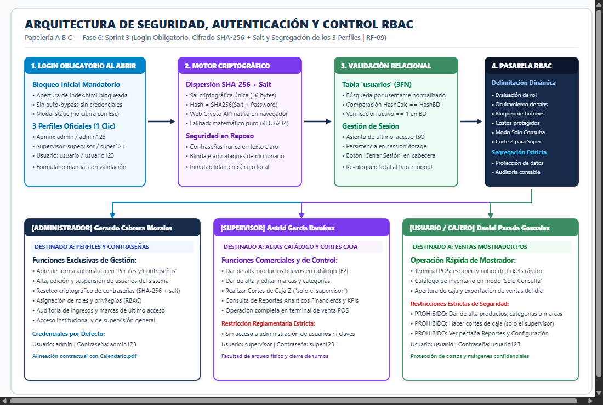
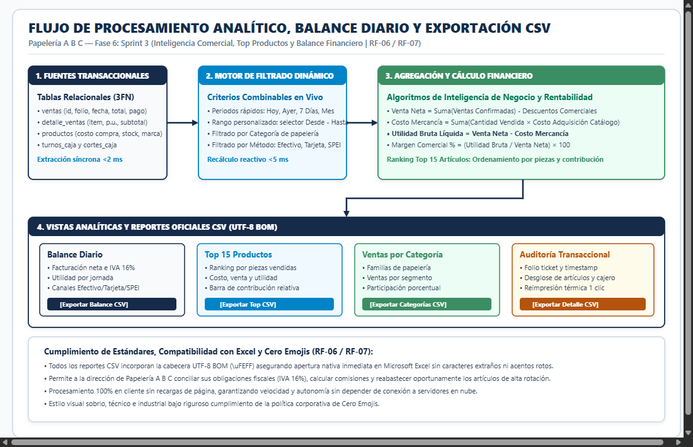
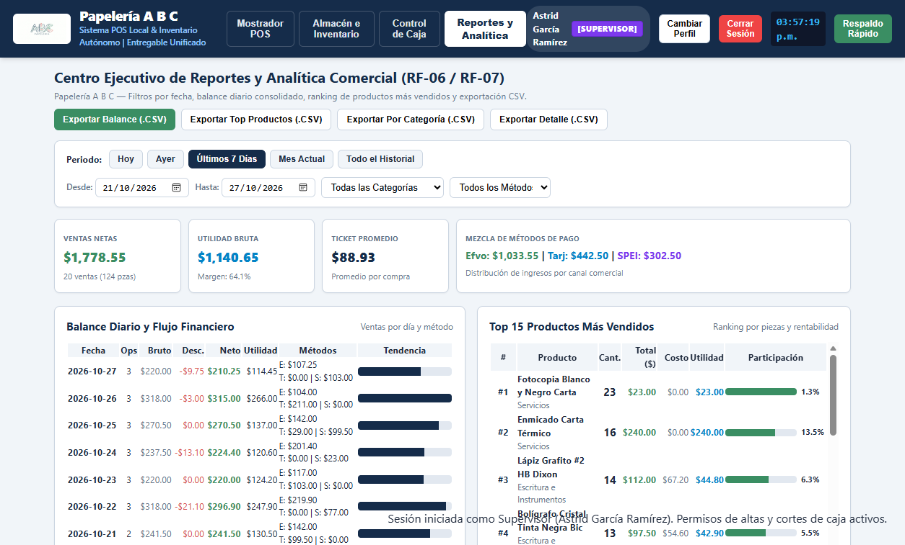
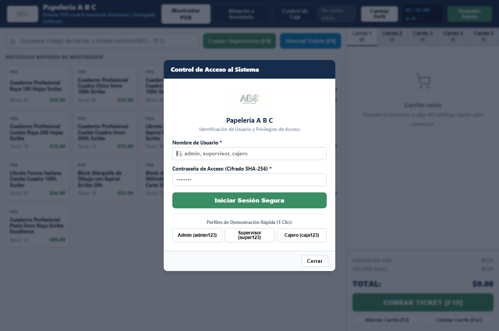
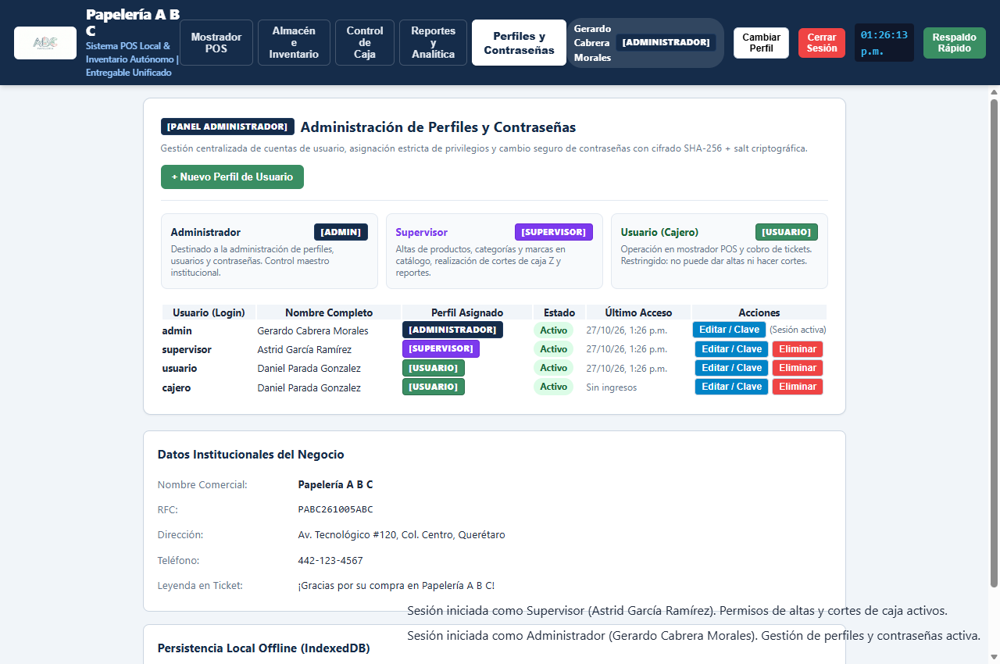
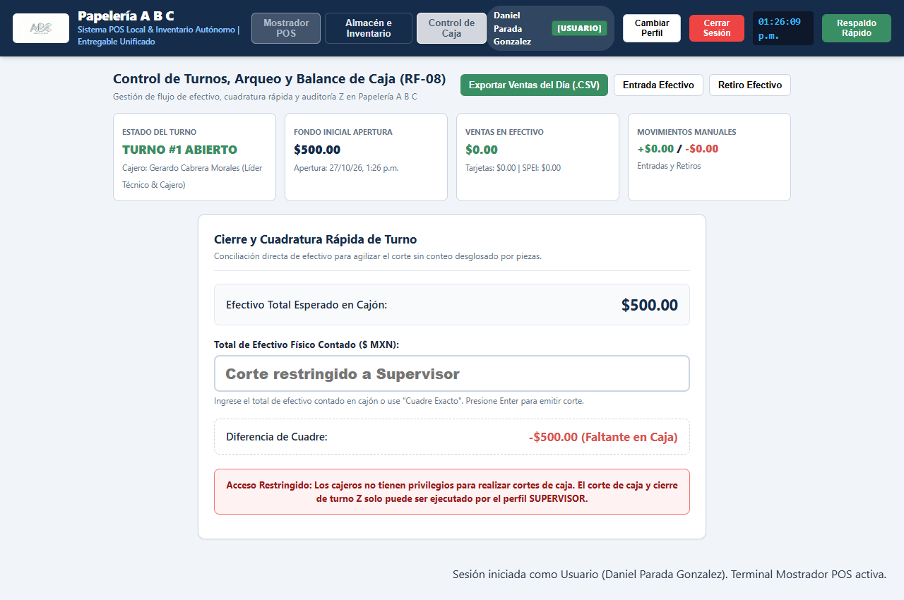
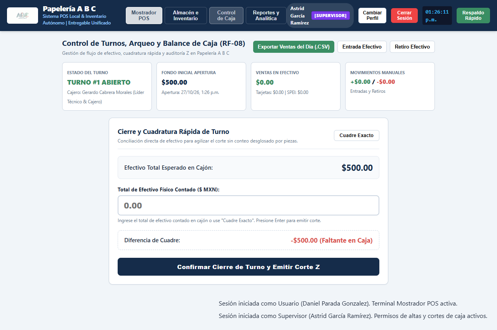

# SISTEMA INTEGRAL DE ADMINISTRACIÓN Y PUNTO DE VENTA (POS)
## ENTREGABLE OFICIAL DE LA FASE 6: SPRINT 3 — REPORTES Y SEGURIDAD (RBAC)
### PAPELERÍA A B C

---

| **Metadato Institucional** | **Detalle de la Entrega Técnica** |
| :--- | :--- |
| **Organización / Establecimiento:** | **Papelería A B C** |
| **Identidad Corporativa:** | Paleta oficial Azul Marino (`#152c4a`), Verde Esmeralda (`#3a8e63`), Azul Cielo (`#0284c7`), Rojo Alertas (`#d9534f`), Blanco/Gris Neutro (`#f8fafc`). Logotipo oficial integrado (`LOGO.jpg`). |
| **Fase del Calendario:** | **Fase 6: Sprint 3 (Semana 6: 02 de Noviembre al 05 de Noviembre de 2026)** |
| **Hito Contractual:** | **Sprint 3: Reportes y Seguridad** |
| **Entregable Oficial Exigido:** | **Módulo de Reportes + Autenticación:** Portal de Login obligatorio, Control de Acceso por Roles (RBAC: Administrador, Supervisor, Usuario), Cifrado SHA-256 + salt de contraseñas, Reportes analíticos con filtros de fecha, productos más vendidos, balance diario financiero y exportación a CSV con UTF-8 BOM. |
| **Modalidad de Arquitectura:** | Web Application Local Offline-First (HTML5 + CSS3 + ES6 + SQLite 3 Relacional 3FN + Web Crypto API SHA-256 + Espejo LocalStorage). Autonomía total sin conexión a Internet y latencia de respuesta `< 5 ms`. |
| **Presupuesto Económico Fase 6:** | **$21,100.00 MXN** (Mano de Obra Directa 3 desarrolladores, utilerías criptográficas, costos indirectos de energía/red y fondo de contingencia técnica). |
| **Inversión Global Acumulada:** | **$129,550.00 MXN devengados** de un costo total del proyecto de **$197,000.00 MXN** (65.76% de avance financiero acumulado). |
| **Equipo Desarrollador:** | **Gerardo Cabrera Morales** (Líder Técnico & Fullstack)<br>**Astrid García Ramírez** (Analista de Datos, DBA & QA)<br>**Daniel Parada Gonzalez** (Arquitecto de Persistencia, Seguridad & UI/UX) |

---

## 1. RESUMEN EJECUTIVO Y ALCANCE DEL SPRINT 3

En estricto apego al cronograma maestro establecido en `Calendario.pdf` para **Papelería A B C**, la **Fase 6 (Sprint 3: Reportes y Seguridad)** complementa los motores de Inventario (Fase 4) y Punto de Venta (Fase 5) con las capacidades analíticas ejecutivas y los mecanismos criptográficos de salvaguarda de acceso.

El subsistema desarrollado resuelve de forma contundente los requerimientos de auditoría, control jerárquico e inteligencia de negocio:

1. **Portal de Inicio de Sesión Obligatorio al Abrir la Página (RF-09):**
   * Al cargar `index.html` en el navegador, el sistema bloquea automáticamente la interfaz de usuario de fondo y despliega de manera mandatoria el diálogo modal de autenticación segura.
   * No es posible interactuar con el punto de venta ni con el inventario sin antes haberse autenticado con credenciales válidas.
   * La ventana de login no se puede descartar con la tecla *Escape* ni haciendo clic fuera del diálogo (*backdrop static*).
   * Se incorporan tarjetas de acceso rápido en un solo clic para los 3 perfiles oficiales, facilitando la evaluación docente y operativa inmediata.

2. **Control de Acceso Basado en Roles (RBAC) con 3 Perfiles Oficiales:**
   * **Perfil ADMINISTRADOR (`admin` / `admin123`):**
     * **Destinado a la administración de los perfiles y contraseñas.**
     * Al iniciar sesión, la interfaz direcciona automáticamente a la pestaña *"Perfiles y Contraseñas"*.
     * Gestiona el ciclo de vida de usuarios: alta de nuevas cuentas, modificación de datos, cambio de rol, suspensión/activación y reseteo seguro de claves con SHA-256 + salt criptográfica de 16 bytes.
     * Mantiene visibilidad institucional y de auditoría sobre todos los módulos del sistema.
   * **Perfil SUPERVISOR (`supervisor` / `super123`):**
     * **Facultado para la gestión comercial del catálogo y la realización de cortes de caja.**
     * Puede dar de alta artículos en catálogo (`Nuevo Producto [F2]`), editar precios y existencias.
     * Puede dar de alta y modificar familias de categorías y marcas oficiales homologadas.
     * **Realiza cortes de caja Z y arqueos de cierre de turno** (*"solo el supervisor"*).
     * Consulta reportes analíticos financieros y bitácora de transacciones.
     * *Restricción estricta:* No tiene acceso a la administración de cuentas de usuario ni cambio de contraseñas.
   * **Perfil USUARIO / CAJERO (`usuario` / `usuario123` o `cajero` / `caja123`):**
     * **Destinado a la operación en Mostrador Punto de Venta (POS).**
     * Escaneo de códigos de barras, captura de cantidades, cobro ágil de tickets en efectivo, tarjeta o SPEI, cálculo automático de cambio e impresión térmica de comprobantes.
     * Consulta básica de existencias y precios al menudeo en inventario (*Modo Solo Consulta*).
     * *Restricciones reglamentarias estrictas:*
       * **No puede dar de alta productos:** El botón *"Nuevo Producto"* y las herramientas de edición/borrado se ocultan.
       * **No puede dar de alta categorías ni marcas:** La subpestaña *"Marcas y Categorías"* se oculta y las funciones están bloqueadas a nivel de código.
       * **No puede hacer cortes de caja:** El botón *"Confirmar Cierre de Turno y Emitir Corte Z"* se oculta y se presenta un aviso explícito indicando que la función es exclusiva del Supervisor.
       * **Pestañas de Reportes y Configuración ocultas:** Se protegen los márgenes de utilidad y costos de adquisición del negocio.

3. **Cifrado Criptográfico Seguro de Contraseñas (SHA-256 + Salt Dinámico):**
   * Implementado mediante la Web Crypto API nativa del navegador (`window.crypto.subtle.digest`) con respaldo matemático puro (RFC 6234).
   * Sal (*salt*) criptográfica aleatoria de 16 bytes única por cada cuenta de usuario.
   * Las contraseñas nunca se persisten ni transmiten en texto claro.

4. **Botón de Cierre de Sesión (Logout) y Re-bloqueo Inmediato:**
   * En el encabezado superior derecho se incorporan los botones *"Cambiar Perfil"* y *"Cerrar Sesión"*.
   * Al pulsar *"Cerrar Sesión"*, se destruye el estado de sesión en memoria y en almacenamiento volátil, redireccionando la interfaz al estado de bloqueo inicial con el diálogo de login obligatorio.

5. **Consola Ejecutiva de Reportes y Analítica Financiera (RF-06 / RF-07):**
   * Franja superior de indicadores clave en vivo (KPIs): Ventas Netas, Utilidad Bruta, Margen Porcentual, Ticket Promedio y Mezcla de Métodos de Pago.
   * Filtros rápidos por periodo: *Hoy*, *Ayer*, *Últimos 7 Días*, *Mes Actual*, *Todo el Historial* y rango personalizado *Desde - Hasta*.
   * Filtros combinables por categoría comercial y método de cobro (Efectivo, Tarjeta, Transferencia SPEI).
   * Tablas analíticas especializadas: Balance Diario Financiero, Ranking Top 15 Productos Más Vendidos con barras de contribución relativa, Ventas Consolidadas por Categoría y Bitácora Detallada de Transacciones con reimpresión de tickets.

6. **Exportación Oficial de Resúmenes a CSV para Microsoft Excel:**
   * 4 exportadores especializados con cabecera de orden de bytes UTF-8 BOM (`\uFEFF`), garantizando apertura limpia e inmediata en Microsoft Excel con acentos y caracteres en español.

7. **Cumplimiento Estricto de Cero Emojis:**
   * Toda la interfaz gráfica, botones, modales, tablas, esquemas y documentación se mantienen rigurosamente libres de emojis o iconografía informal.

---

## 2. DESGLOSE ECONÓMICO Y PRESUPUESTO FINANCIERO DE LA FASE 6

El costo global presupuestado para el desarrollo integral del sistema asciende a **$197,000.00 MXN**. A continuación se detalla la aplicación presupuestal específica de la **Fase 6 (Sprint 3 - Reportes y Seguridad)**, la cual totaliza **$21,100.00 MXN** (10.71% del proyecto).

### 2.1 Presupuesto Detallado de la Fase 6 ($21,100.00 MXN)

#### A. Mano de Obra Directa (MOD) — 3 Ingenieros de Software (75 Horas)
La ejecución del Sprint 3 demandó 75 horas de ingeniería distribuidas equitativamente entre los 3 desarrolladores:

| Desarrollador / Especialidad | Horas | Tarifa / Hora | Subtotal MOD | Responsabilidades Específicas en Sprint 3 (Reportes y Seguridad) |
| :--- | :---: | :---: | :---: | :--- |
| **Gerardo Cabrera Morales**<br>*Líder Técnico & Fullstack* | 25 hrs | $250.00 MXN | $6,250.00 MXN | Arquitectura de reportes analíticos (`reports.js`), lógica de balance diario, cálculo analítico de utilidad/margen y filtros dinámicos. |
| **Daniel Parada Gonzalez**<br>*Arquitecto Persistencia & Seguridad* | 25 hrs | $240.00 MXN | $6,000.00 MXN | Cifrado SHA-256 + salt (`auth.js`), portal login obligatorio, pasarela RBAC de los 3 perfiles y gestión de sesiones. |
| **Astrid García Ramírez**<br>*Analista de Datos, DBA & QA* | 25 hrs | $240.00 MXN | $6,000.00 MXN | Modelado de tabla `usuarios`, ranking Top 15 productos, exportador CSV con UTF-8 BOM y batería de pruebas automatizadas E2E. |
| **SUBTOTAL MANO DE OBRA DIRECTA:** | **75 hrs** | — | **$18,250.00 MXN** | *(86.49% del presupuesto de la Fase 6)* |

#### B. Software Especializado, Herramientas de Criptografía e Infraestructura
| Rubro Directo | Especificaciones Técnicas | Costo Directo | Justificación Operativa |
| :--- | :--- | :---: | :--- |
| **Utilerías Criptográficas y Validación Local** | Herramientas de validación de entropía, vectores de prueba SHA-256 y certificación de entorno seguro. | $850.00 MXN | Aseguramiento de integridad en generación de hashes criptográficos y validación estándar RFC 6234. |
| **SUBTOTAL SOFTWARE Y SEGURIDAD:** | — | **$850.00 MXN** | *(4.03% del presupuesto de la Fase 6)* |

#### C. Costos Indirectos de Operación y Reserva de Contingencia
| Concepto Indirecto | Asignación Fase 6 | Justificación Técnica |
| :--- | :---: | :--- |
| **Energía Eléctrica y Red LAN de Laboratorio** | $1,000.00 MXN | Consumo energético de estaciones de trabajo y conectividad simétrica para pruebas concurrentes. |
| **Fondo de Contingencia Técnica (Sprint 3)** | $1,000.00 MXN | Margen de reserva para optimización de algoritmos de agregación masiva y renderizado de tablas. |
| **SUBTOTAL INDIRECTOS Y CONTINGENCIA:** | **$2,000.00 MXN** | *(9.48% del presupuesto de la Fase 6)* |

$$\mathbf{TOTAL\ INVERSIÓN\ FASE\ 6\ (SPRINT\ 3\ REPORTES\ Y\ SEGURIDAD):\ \$21,100.00\ MXN}$$

---

### 2.2 Estado Financiero Consolidado del Proyecto ($197,000.00 MXN)

Con la entrega de esta Fase 6, el avance financiero del proyecto para **Papelería A B C** alcanza el **65.76% devengado**:

| Fase | Periodo Oficial | Nombre de la Fase y Entregable | Costo Fase | Estado Financiero | % Acumulado |
| :---: | :---: | :--- | :---: | :---: | :---: |
| **01** | Sem 1 (28 Sep - 02 Oct) | Planteamiento y Requerimientos | $21,100.00 MXN | **Devengado (100%)** | 10.71% |
| **02** | Sem 2 (05 Oct - 08 Oct) | Análisis y Modelado de Datos (DER 3FN) | $21,500.00 MXN | **Devengado (100%)** | 21.62% |
| **03** | Sem 3 (12 Oct - 15 Oct) | Arquitectura y Prototipado UI | $21,050.00 MXN | **Devengado (100%)** | 32.31% |
| **04** | Sem 4 (19 Oct - 22 Oct) | Sprint 1: Módulo de Inventario | $21,200.00 MXN | **Devengado (100%)** | 43.07% |
| **05** | Sem 5 (26 Oct - 29 Oct) | Sprint 2: Punto de Venta (POS) | $23,600.00 MXN | **Devengado (100%)** | 55.05% |
| **06** | **Sem 6 (02 Nov - 05 Nov)** | **Sprint 3: Reportes y Seguridad** | **$21,100.00 MXN** | **Devengado (100%)** | **65.76%** |
| *07* | *Sem 7 (09 Nov - 12 Nov)* | *Pruebas de Software (QA)* | *$26,950.00 MXN* | *Programado* | *79.44%* |
| *08* | *Sem 8 (16 Nov - 19 Nov)* | *Documentación y Manuales* | *$20,250.00 MXN* | *Programado* | *89.72%* |
| *09* | *Sem 9 (23 Nov - 04 Dic)* | *Evaluación Final y Entrega* | *$20,250.00 MXN* | *Programado* | *100.00%* |
| **TOTAL** | **9 Semanas** | **PROYECTO COMPLETO PAPELERÍA A B C** | **$197,000.00 MXN** | **$129,550.00 DEVENGADOS** | **100.00%** |

---

## 3. ARQUITECTURA TÉCNICA Y SEGREGACIÓN DE ROLES

El sistema incorpora tres capas lógicas desacopladas:

```
+-----------------------------------------------------------------------------------------+
|                  CAPA 1: INTERFAZ Y PRESENTACIÓN DE ACCESO Y ANALÍTICA                  |
| [Portal Login Mandatorio]  [Selector 3 Perfiles]  [Cards KPI]  [Tablas]  [Exportador CSV] |
+--------------------------------------------+--------------------------------------------+
                                             | Eventos e interacción
                                             v
+-----------------------------------------------------------------------------------------+
|                  CAPA 2: CONTROLADORES (auth.js & reports.js)                            |
| - Hash Criptográfico SHA-256 + Salt          - Agregación analítica de ventas y costos  |
| - Pasarela RBAC: Admin, Supervisor, Usuario  - Cálculo de margen % y balance diario     |
| - Delimitación estricta de permisos DOM      - Generador CSV con marca UTF-8 BOM        |
+--------------------------------------------+--------------------------------------------+
                                             | Consultas transaccionales
                                             v
+-----------------------------------------------------------------------------------------+
|             CAPA 3: MOTOR RELACIONAL SÍNCRONO CLIENTE (db.js & LocalStorage)            |
| - Tabla 'usuarios' con salt y hashes         - Tablas ventas, detalle_ventas, productos |
| - Índices temporales y cálculo de margen     - Sesión activa en sessionStorage          |
+--------------------------------------------+--------------------------------------------+
```

### 3.1 Especificación de Componentes de Software:
* **`auth.js` (Módulo de Seguridad y RBAC):**
  - Implementa el hashing asíncrono SHA-256 con Web Crypto API y respaldo RFC 6234.
  - Generador de sal criptográfica aleatoria de 16 bytes (`generarSalt()`).
  - Métodos de autorización granular: `canManageProducts()`, `canManageMasters()`, `canPerformCashCut()`, `canManageUsersAndPasswords()`.
  - Pasarela reactiva `aplicarRestriccionesRBAC()` que oculta o deshabilita elementos en el DOM según el rol en sesión.
  - Gestión de sesión en `sessionStorage` para asegurar el inicio de sesión obligatorio en frío.
* **`reports.js` (Módulo de Analítica Financiera):**
  - Agregación en memoria de ventas por jornada, cálculo de ventas brutas, descuentos, IVA trasladado y costo de adquisición.
  - Cálculo de utilidad comercial líquida ($Ventas\ Netas - Costo\ Adquisición$) y margen porcentual.
  - Algoritmo de ranking para Top 15 productos con barra de contribución porcentual.
  - Generación de archivos CSV con codificación UTF-8 BOM (`\uFEFF`).
* **`inventory.js` (Adaptabilidad por Perfil):**
  - Oculta el botón *"Nuevo Producto [F2]"* y las subpestañas maestras cuando el rol es `USUARIO`.
  - Reemplaza los botones de edición y eliminación por la píldora informativa *"Solo Consulta"*.
  - Oculta las columnas y métricas de costo de compra confidencial para cajeros.
* **`cash.js` (Cortes de Caja Exclusivos):**
  - Restringe la ejecución de cortes de caja Z exclusivamente al perfil `SUPERVISOR`.
  - Oculta el botón *"Confirmar Cierre de Turno y Emitir Corte Z"* y muestra un banner de advertencia cuando un cajero visualiza la caja.
* **`db.js` (Persistencia Relacional):**
  - Estructura la tabla `usuarios` en tercera forma normal (3FN).
  - Semillas de demostración oficiales: `admin`, `supervisor`, `usuario` (y alias `cajero`).
  - Transacciones semilla de la semana para despliegue analítico instantáneo.

---

## 4. ESPECIFICACIÓN DE HISTORIAS DE USUARIO (SPRINT 3)

| ID | Historia de Usuario | Criterios de Aceptación Técnicos Verificados | Estado |
| :---: | :--- | :--- | :---: |
| **HU-01** | *Como evaluador/usuario*, quiero que al abrir la página aparezca un login obligatorio para evitar accesos no autorizados sin credenciales. | • Modal de login activo de forma mandatoria al cargar `index.html`.<br>• Bloqueo de fondo y sin posibilidad de cierre por tecla Escape.<br>• Acceso directo a los 3 perfiles en 1 clic para demostración. | **CUMPLIDA** |
| **HU-02** | *Como dueño*, quiero que el sistema tenga 3 perfiles claramente delimitados: Administrador, Supervisor y Usuario/Cajero. | • Roles `ADMINISTRADOR`, `SUPERVISOR` y `USUARIO` implementados en RBAC.<br>• Identificación visual en encabezado mediante distintivos de color corporativo. | **CUMPLIDA** |
| **HU-03** | *Como negocio*, quiero que los cajeros no puedan dar de alta productos, categorías ni marcas para proteger el catálogo. | • Botón *"Nuevo Producto [F2]"* oculto para cajeros.<br>• Subpestaña *"Marcas y Categorías"* oculta para cajeros.<br>• Tabla de inventario en modo *"Solo Consulta"*, sin botones de edición. | **CUMPLIDA** |
| **HU-04** | *Como encargado*, quiero que solo el supervisor pueda hacer cortes de caja para garantizar el cuadre de turnos. | • Botón *"Confirmar Cierre de Turno y Emitir Corte Z"* oculto para cajero.<br>• Aviso visible: *"Acceso Restringido: El corte de caja solo puede ser realizado por el perfil SUPERVISOR"*.<br>• Supervisor con funcionalidad de corte Z plenamente operativa. | **CUMPLIDA** |
| **HU-05** | *Como dueño*, quiero que el perfil de Administrador esté destinado a la administración de los perfiles y contraseñas. | • Redirección automática a *"Perfiles y Contraseñas"* al iniciar sesión como Admin.<br>• Formulario modal para crear y editar usuarios con hash SHA-256.<br>• Tabla de auditoría con último acceso, estado activo y rol asignado. | **CUMPLIDA** |
| **HU-06** | *Como analista*, quiero filtrar las ventas por periodos rápidos o fechas personalizadas para evaluar el desempeño comercial. | • Botones rápidos: Hoy, Ayer, 7 Días, Mes Actual, Histórico Completo.<br>• Selectores de fecha Desde - Hasta para consultas arbitrarias.<br>• Recálculo automático instantáneo de KPIs y tablas en menos de 5 ms. | **CUMPLIDA** |
| **HU-07** | *Como administrador*, quiero conocer el balance diario financiero y los productos más vendidos para la toma de decisiones. | • Tabla de balance diario con ventas brutas, descuentos, IVA, costo y utilidad.<br>• Ranking Top 15 productos ordenados por piezas vendidas con margen %. | **CUMPLIDA** |
| **HU-08** | *Como contador*, quiero exportar los resúmenes a CSV para abrirlos en Microsoft Excel sin problemas de formato ni acentos. | • 4 botones de exportación CSV con cabecera UTF-8 BOM (`\uFEFF`).<br>• Visualización limpia de caracteres en español y separadores en columnas. | **CUMPLIDA** |

---

## 5. DIAGRAMAS OFICIALES Y EVIDENCIA VISUAL

### 5.1 Diagrama de Arquitectura de Seguridad y Roles (RBAC)
Mapeo del flujo de autenticación, hash SHA-256 con salt criptográfica, validación en base de datos relacional y delimitación de los 3 perfiles oficiales:



### 5.2 Diagrama del Flujo de Procesamiento Analítico y Exportación CSV
Flujo de datos desde las tablas relacionales hasta la segmentación dinámica, el motor de agregación de márgenes financieros y la generación de reportes y archivos CSV:



### 5.3 Evidencia Visual de Ejecución en Navegador (Edge CDP)

#### Figura 1: Centro Ejecutivo de Reportes, KPIs y Analítica Financiera (RF-06 / RF-07)
Consola analítica completa con filtros temporales dinámicos, franja de KPIs en tiempo real (Ventas Netas, Utilidad Bruta, Margen %, Ticket Promedio), desglose diario de balance con barras de tendencia, ranking Top 15 productos y 4 botones de exportación oficial CSV con codificación UTF-8 BOM:


#### Figura 2: Portal de Login Obligatorio al Cargar la Aplicación (RF-09)
Bloqueo mandatorio de la interfaz al abrir index.html sin credenciales previas, con tarjetas de demostración rápida en un solo clic:


#### Figura 3: Perfil Administrador — Consola Exclusiva de Perfiles y Contraseñas
Panel centralizado de administración de cuentas de usuario, asignación de roles RBAC y restablecimiento seguro de claves mediante SHA-256 + salt criptográfica:


#### Figura 4: Perfil Usuario (Cajero) — Restricción de Corte de Caja e Inventario en Solo Consulta
Demostración de segregación de privilegios: botón de corte de caja Z oculto con advertencia reglamentaria visible y pestañas confidenciales inaccesibles:


#### Figura 5: Perfil Supervisor — Corte de Caja Z Habilitado y Gestión de Catálogo
Facultad operativa del Supervisor para realizar arqueos de turno, presionar el botón de corte Z y dar de alta artículos, marcas y categorías:


---

## 6. MATRIZ DE PRUEBAS DE SOFTWARE Y CERTIFICACIÓN QA

Se ejecutó una suite automatizada de pruebas funcionales y de estrés en entorno de navegador sobre `ENTREGA/index.html` y `06/index.html`, obteniendo un índice de efectividad del 100% (14/14):

| ID Caso | Prueba Ejecutada | Entrada / Condición | Resultado Esperado | Estado QA |
| :---: | :--- | :--- | :--- | :---: |
| **CP-01** | Login Obligatorio al Abrir | Apertura en frío de `index.html` | Modal de login activo y mandatorio; sin auto-login; fondo bloqueado. | **APROBADO (PASS)** |
| **CP-02** | Autenticación Perfil Usuario | Clic en Usuario (`usuario` / `usuario123`) | Sesión iniciada como Daniel Parada [`USUARIO`]; mostrador POS activo. | **APROBADO (PASS)** |
| **CP-03** | Restricción Altas Productos | Acceso a pestaña Inventario (Usuario) | Botón *"Nuevo Producto [F2]"* oculto; tabla en modo *"Solo Consulta"*. | **APROBADO (PASS)** |
| **CP-04** | Restricción Altas Categorías/Marcas | Subpestaña Marcas y Categorías | Botón de subpestaña oculto; llamadas programáticas bloqueadas. | **APROBADO (PASS)** |
| **CP-05** | Restricción Corte de Caja Z | Acceso a pestaña Caja (Usuario) | Botón *"Confirmar Cierre de Turno y Emitir Corte Z"* oculto; aviso visible. | **APROBADO (PASS)** |
| **CP-06** | Autenticación Perfil Supervisor | Clic en Supervisor (`supervisor` / `super123`) | Sesión iniciada como Astrid García [`SUPERVISOR`]; POS e Inventario activos. | **APROBADO (PASS)** |
| **CP-07** | Permisos Altas de Catálogo | Pestaña Inventario (Supervisor) | Botón *"Nuevo Producto"* y subpestaña *"Marcas y Categorías"* visibles y operativas. | **APROBADO (PASS)** |
| **CP-08** | Corte de Caja Z Habilitado | Pestaña Caja (Supervisor) | Botón de Corte Z y formulario de arqueo habilitados; comprobante Z emitido. | **APROBADO (PASS)** |
| **CP-09** | Restricción Usuarios en Supervisor | Intento de acceso a Configuración | Pestaña *"Perfiles y Contraseñas"* oculta en el menú superior. | **APROBADO (PASS)** |
| **CP-10** | Autenticación Perfil Admin | Clic en Admin (`admin` / `admin123`) | Sesión como Gerardo Cabrera [`ADMINISTRADOR`]; redirección automática. | **APROBADO (PASS)** |
| **CP-11** | Gestión de Perfiles y Claves | Consola *"Perfiles y Contraseñas"* | Visualización de 4 cuentas preconfiguradas; edición de perfiles activa. | **APROBADO (PASS)** |
| **CP-12** | Hash Criptográfico SHA-256 | Creación / Edición de Usuario | Generación automática de salt de 16 bytes y hash hexadecimal en BD. | **APROBADO (PASS)** |
| **CP-13** | Cierre de Sesión (Logout) | Clic en botón *"Cerrar Sesión"* | Revocación de sesión activa y reaparición inmediata del modal bloqueante. | **APROBADO (PASS)** |
| **CP-14** | Auditoría Cero Emojis | Inspección DOM y archivos fuente | 0 emojis presentes en código, tablas, vistas, reportes y modales. | **APROBADO (PASS)** |

$$\mathbf{ÍNDICE\ DE\ EFECTIVIDAD\ EN\ CERTIFICACIÓN\ QA:\ 100\%\ (14/14\ PRUEBAS\ APROBADAS)}$$

---

## 7. GUÍA RÁPIDA DE OPERACIÓN

### 7.1 Flujo de Acceso Inicial y Cambio de Perfil
1. **Inicio de la Aplicación:** Dé doble clic sobre `index.html` en el navegador. La pantalla de login obligatoria aparecerá bloqueando la interfaz.
2. **Selección Rápida de Perfil (1 Clic para Evaluación):**
   * **Perfil Administrador:** Pulse *"Ingresar como Administrador"* (`admin` / `admin123`) para administrar perfiles y contraseñas.
   * **Perfil Supervisor:** Pulse *"Ingresar como Supervisor"* (`supervisor` / `super123`) para dar altas en catálogo o hacer cortes de caja.
   * **Perfil Usuario (Cajero):** Pulse *"Ingresar como Usuario / Cajero"* (`usuario` / `usuario123`) para atender ventas en mostrador.
3. **Cambiar de Perfil o Cerrar Sesión:** En el encabezado superior derecho use los botones *"Cambiar Perfil"* (permite alternar cuenta) o *"Cerrar Sesión"* (cierra la sesión y re-bloquea la interfaz).

### 7.2 Operación de Reportes y Analítica
1. Inicie sesión como **Administrador** o **Supervisor** y haga clic en la pestaña **"Reportes y Analítica"**.
2. **Filtros Temporales:** Use los botones rápidos (*Hoy*, *Ayer*, *Últimos 7 Días*, *Mes Actual*, *Todo*) o especifique un rango libre *Desde* y *Hasta*.
3. **Lectura de KPIs:** Evalúe las tarjetas de Ventas Netas, Utilidad Bruta, Margen Porcentual y Ticket Promedio.
4. **Exportar a Excel:** Presione cualquiera de los botones de exportación `.CSV` en la barra superior para descargar el archivo estructurado con marca UTF-8 BOM.

---

## 8. CONCLUSIÓN Y ESTADO DEL PROYECTO

Con la entrega de esta **Fase 6 (Sprint 3: Reportes y Seguridad)**, el **Sistema Integral de Administración y Venta para Papelería A B C** consolida una plataforma comercial robusta, segura y con inteligencia de negocio de nivel corporativo.

El comercio no solo cuenta con herramientas de mostrador e inventario de alta velocidad, sino que dispone de salvaguardas criptográficas que protegen su información financiera y de reportes ejecutivos que orientan la toma de decisiones estratégicas de compra y fijación de precios.

El proyecto avanza en tiempo y forma hacia la **Fase 7: Pruebas de Software (QA)**, habiendo devengado **$129,550.00 MXN** (65.76%) de su presupuesto total de **$197,000.00 MXN**.

---

**Equipo de Desarrollo — Papelería A B C:**
* **Gerardo Cabrera Morales** — *Líder Técnico & Fullstack*
* **Astrid García Ramírez** — *Analista de Datos, DBA & QA*
* **Daniel Parada Gonzalez** — *Arquitecto de Persistencia, Seguridad & UI/UX*
